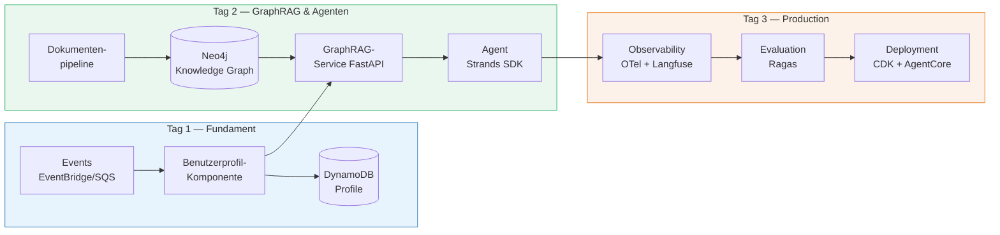
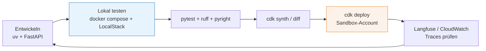

# Architecting AI-Ready Applications — Schulungs-Repository

Zentrales Repo der 3-tägigen Schulung **"Architecting AI-Ready Applications – Softwarearchitektur für KI-Systeme"**.
Offizielle Agenda: [docs/agenda.md](docs/agenda.md) · **Alle Dokumente: [docs/inhalt.md](docs/inhalt.md)**

> **Status: Inhaltlich fertig.** Alle 16 Kapitel (3 Tage) haben `theorie.md` (Slidev-Deck), `demo/`, `uebung.md` und `loesung/` — der Code ist live gegen AWS/Bedrock bzw. per CDK-Assertion getestet. Dieses README hält die Stack- und Strukturentscheidungen fest; offene Vor-der-Schulung-Punkte stehen in `.claude/TODOs.md`.

---

## Leitidee

Über drei Tage entsteht schrittweise **eine durchgängige Beispielanwendung**: eine event-getriebene, daten-zentrierte Enterprise-Anwendung mit KI-Personalisierung (Tag 1), GraphRAG-basierter Wissenssuche und Agenten (Tag 2), die produktionsreif gemacht wird — Observability, Evaluation, Security, Kosten, Deployment (Tag 3).



---

## Schulungsform

- Pro Kapitel: **~15 % Theorie** (`theorie.md`, kurz, mit expliziten Limits: was geht, was geht *nicht*), **~15 % Vorführung** durch den Trainer (`demo/`), **~70 % Praxis** der Teilnehmer (`uebung.md` + `loesung/`).
- Übungen sind bewusst **leicht komplexer** als die Demo — Teilnehmer sollen etwas knobeln und auch mal in die Docs schauen, ohne überfordert zu werden.
- Setup von Infrastruktur, Services und Tooling ist **Teil der Schulung** (geführt, Tag 1); geführte Kapitel haben zusätzlich ein `trainer.md`-Runbook.
- **Folien:** jede `theorie.md` ist ein [Slidev](https://sli.dev/)-Deck (Markdown mit Mermaid, Speaker Notes, Zeichnen/Annotieren im Vortrag). `npm install` einmalig, dann **`npm run deck`** — [folien.md](folien.md) importiert alle Kapitel-Decks zu einer Gesamtpräsentation. Einzelnes Kapitel: `npm run slides -- <kapitel>/theorie.md --open`.
- Erklärgrafiken: einfache Mermaid-Diagramme (max. 20 Nodes, dezente Farben).

## Stack-Entscheidungen

### Sprache & Tooling

| Bereich | Wahl | Begründung |
|---|---|---|
| Sprache | [Python ≥ 3.12](https://docs.python.org/3/) | Vorgabe; De-facto-Standard im AI-Umfeld |
| Paket-/Projektmanagement | **[uv](https://docs.astral.sh/uv/)** | Schnell, lockfile-basiert, ein Tool für venv + deps + run |
| Lint/Format | **[ruff](https://docs.astral.sh/ruff/)** | Ersetzt black/isort/flake8 in einem Tool |
| Typprüfung | **[pyright](https://microsoft.github.io/pyright/)** (strict) | Schnell, präzise; Pydantic-v2-Support |
| Tests | **[pytest](https://docs.pytest.org/)** | Standard |
| Datenmodelle | **[Pydantic v2](https://docs.pydantic.dev/latest/)** | Validierung an allen Service-Grenzen |
| API | **[FastAPI](https://fastapi.tiangolo.com/)** | Async, OpenAPI out of the box, Pydantic-nativ |

### KI-Kernstack

| Bereich | Wahl | Alternative (erwähnt in Theorie) |
|---|---|---|
| LLM & Embeddings | **[Amazon Bedrock](https://docs.aws.amazon.com/bedrock/)** (Claude-Modelle; Titan/Cohere Embeddings) | OpenAI/Azure OpenAI, selbst gehostete Modelle |
| Agent-Framework | **[Strands Agents SDK](https://strandsagents.com/docs/)** (AWS, Open Source, model-agnostisch; Repo: [strands-agents/harness-sdk](https://github.com/strands-agents/harness-sdk)) | [LangGraph](https://langchain-ai.github.io/langgraph/), [LlamaIndex](https://docs.llamaindex.ai/), [CrewAI](https://docs.crewai.com/) |
| Agent-Runtime (Prod) | **[Amazon Bedrock AgentCore](https://docs.aws.amazon.com/bedrock-agentcore/latest/devguide/what-is-bedrock-agentcore.html)** (Runtime, Memory, Gateway, Observability) | Eigenes ECS/Lambda-Deployment |
| RAG-Ansatz | **GraphRAG**: [Neo4j](https://neo4j.com/docs/) Knowledge Graph + [nativer Vector Index](https://neo4j.com/docs/cypher-manual/current/indexes/semantic-indexes/vector-indexes/), Paket [`neo4j-graphrag`](https://neo4j.com/docs/neo4j-graphrag-python/current/) — auch die Vector-RAG-Baseline läuft auf dem Neo4j Vector Index (eine DB für Vektor **und** Graph) | [Bedrock Knowledge Bases](https://docs.aws.amazon.com/bedrock/latest/userguide/knowledge-base.html) (verworfen: Standard-Vektorstore OpenSearch Serverless hat Stundengrundkosten; GraphRAG-Variante braucht Neptune Analytics; Blackbox statt Lerneffekt), [Microsoft GraphRAG](https://microsoft.github.io/graphrag/), [LightRAG](https://github.com/HKUDS/LightRAG) |
| Tool-Anbindung | **[MCP](https://modelcontextprotocol.io/)** (Model Context Protocol) | Direkte Tool-Definitionen im Framework |
| Evaluation | **[Ragas](https://docs.ragas.io/)** (+ LLM-as-Judge) | [DeepEval](https://deepeval.com/docs/getting-started) |
| LLM-Observability | **[OpenTelemetry GenAI Semantic Conventions](https://opentelemetry.io/docs/specs/semconv/gen-ai/)** → **[Langfuse](https://langfuse.com/docs)** (self-hosted) | [LangSmith](https://docs.langchain.com/langsmith/), [Phoenix/Arize](https://arize.com/docs/phoenix), [MLflow Tracing](https://mlflow.org/docs/latest/genai/tracing/) |

**Abgrenzung [AgentCore Memory](https://docs.aws.amazon.com/bedrock-agentcore/latest/devguide/memory-strategies.html) vs. Neo4j:** AgentCore Memory ist *Konversationsgedächtnis* (Short-Term: Session-Events; Long-Term: per Strategie extrahierte Fakten/Präferenzen/Summaries). Es ist **kein** Ersatz für den Knowledge Graph: kein Dokumenten-Ingest, kein Cypher/Graph-Traversal, kein Hybrid-Retrieval über einen Korpus. In der Schulung: Neo4j für GraphRAG/Wissensbasis (Tag 2), AgentCore Memory als Agent-Gedächtnis-Thema (Tag 3). Neo4j-Anbindung an Agenten läuft über die offiziellen [Neo4j-MCP-Server](https://neo4j.com/docs/mcp/current/) bzw. `neo4j-graphrag`-Retriever als Tool.

### Daten & Events

| Bereich | Wo läuft es | Details |
|---|---|---|
| Knowledge Graph **+ alle Vektoren** | [Neo4j Community](https://neo4j.com/docs/operations-manual/current/docker/) im Docker-Container: lokal via Compose, deployt auf [EC2](https://docs.aws.amazon.com/ec2/) (Tag 2/3, gleiche Konfig) | Eine DB für Graph **und** [Vector Index](https://neo4j.com/docs/cypher-manual/current/indexes/semantic-indexes/vector-indexes/) — bewusst kein pgvector/Postgres mehr (weniger Tool-Vielfalt). Das native Pendant [Amazon Neptune](https://docs.aws.amazon.com/neptune/) ist zu teuer und ohne Standard-Cypher — Theorie-/Kosten-Punkt |
| Key-Value: Profile, Signale | [DynamoDB](https://docs.aws.amazon.com/dynamodb/) (AWS direkt, on-demand) | pro Request abgerechnet, kein Leerlaufpreis |
| Objekte / Dokumente | [S3](https://docs.aws.amazon.com/s3/) (AWS direkt) | |
| Events / Messaging | [EventBridge](https://docs.aws.amazon.com/eventbridge/), [SQS](https://docs.aws.amazon.com/sqs/), [SNS](https://docs.aws.amazon.com/sns/) (AWS direkt) | |
| Serverless Compute | [Lambda](https://docs.aws.amazon.com/lambda/) (AWS direkt) | |

**AWS-first-Prinzip (seit 07/2026):** Übungen, Demos und Tests laufen direkt gegen den eigenen AWS-Sandbox-Account — kein Umgebungs-Hin-und-Her. [LocalStack](https://docs.localstack.cloud/) wird in `tag-1/02` einmal als Option gezeigt (Compose-Profil `emulation`), danach nicht mehr verwendet. Lokal läuft nur noch, was kein AWS-Pendant im Einsatz hat: `neo4j` (Kern) und `langfuse` (Profil `observability`).

**Kosten:** Alle Standard-Services sind nutzungsbasiert (3 Tage ≈ einstelliger Euro-Betrag pro Teilnehmer, größter Posten Bedrock-Tokens). Einzige Stundenpreis-Ressource ist die Neo4j-EC2-Instanz (~0,50 $/Tag) — **nach jedem Schulungstag zerstören**; Kostenfallen-Liste im [Kosten-Radar](tag-1/03-setup-aws/trainer.md).

**Rolle von LocalStack (bewusst begrenzt):** Warm-up vor dem AWS-Zugang (Kapitel 02), Substrat für schnelle pytest-Läufe und Offline-Fallback. Ab Kapitel 04 ist **echtes AWS der Primärweg** — LocalStack erzwingt kein IAM und kennt kein Bedrock; Rechte- und Policy-Fehler zeigen sich nur in der echten Cloud. Postgres und Neo4j sind davon unabhängig: die laufen lokal nativ im Container, ohne Emulation.

### Infrastructure as Code

**Entscheidung: [AWS CDK v2](https://docs.aws.amazon.com/cdk/v2/guide/) in Python.**

- Infra in echtem Python (Vorgabe "ideally python"), gleiche Sprache wie Anwendungs- und KI-Code, gleiche Tooling-Kette (uv, ruff, pyright).
- AWS-native: L2/L3-Constructs kodieren AWS-Best-Practices (IAM least privilege, Verschlüsselung) mit; wir sind zu 100 % auf AWS, Multi-Cloud-Vorteil von Terraform/OpenTofu entfällt.
- [CDKTF](https://developer.hashicorp.com/terraform/cdktf) (Terraform-CDK) wurde 2025 von HashiCorp eingestellt — CDK ist damit der klare AWS-Python-Weg. [OpenTofu](https://opentofu.org/docs/)/[Terraform](https://developer.hashicorp.com/terraform/docs) wird in der Theorie als verbreitete Alternative eingeordnet (deklarativ, Multi-Cloud, HCL), [Pulumi](https://www.pulumi.com/docs/) als Python-Alternative mit eigenem State-Backend.
- Struktur: `infrastructure/` als eigenes uv-Projekt mit CDK-App und Stacks pro Themenblock (`NetworkStack`, `DataStack`, `AiStack`, `ObservabilityStack`).
- Region: `eu-west-1` (Bedrock-Modellverfügbarkeit dort je Kapitel vorab verifiziert).

### Entwicklungs-Workflow



## Tagesplanung (Kapitelübersicht)

### Tag 1 — Event-Driven & daten-zentrierte Grundlagen (`tag-1/`)

1. **01-architektur-fuer-ki** — Rolle der Softwarearchitektur in KI-Systemen; Abgrenzung Data Science / MLOps / Software-Architektur; AI-Ready-Qualitätsmerkmale
2. **02-setup-lokal** *(geführt)* — uv, Projektstruktur, `docker-compose.yml`, LocalStack, Smoke-Tests
3. **03-setup-aws** *(geführt)* — AWS-Konto/SSO, CDK Bootstrap, Bedrock Model Access, erster `cdk deploy`
4. **04-event-driven-ki-workloads** — EventBridge/SQS-Patterns für KI-Workloads (async, Retry, DLQ, Idempotenz)
5. **05-daten-zentrierte-persistenz** — Persistenzkonzepte für AI-Ready-Anwendungen: Postgres/pgvector, DynamoDB, S3; Embedding-Lifecycle
6. **06-praxis-benutzerprofil** — Praxisbeispiel der Agenda: event-getriebene Benutzerprofil-Komponente für KI-Personalisierung (ganztags-übergreifende Übung, führt Kapitel 4+5 zusammen)

### Tag 2 — GraphRAG & KI-zentrierte Services (`tag-2/`)

1. **01-genai-anwendungsarchitektur** — Bausteine einer GenAI-Anwendung; Bedrock-Modellwahl; Prompt-/Context-Design; strukturierte Outputs
2. **02-dokumentenpipeline-embeddings** — Chunking, Embeddings, Indizes, Query-Flow; Vector-RAG als Baseline (pgvector)
3. **03-graphrag** — Knowledge-Graph-Aufbau mit `neo4j-graphrag` (Entity-/Relation-Extraktion), Hybrid Retrieval (Graph + Vektor), Vergleich zur Baseline
4. **04-ki-services-in-microservices** — GraphRAG als FastAPI-Service; Integration in Microservice-Landschaften; Domänenmodell ↔ KI-Komponente
5. **05-agenten-orchestrierung** — KI-Funktionen und Agenten orchestrieren: Strands Agents, Tools via MCP; Service-Mesh vs. Orchestrierungs-Framework

### Tag 3 — Production-Readiness, Sicherheit & Kosten (`tag-3/`)

1. **01-observability** — OTel GenAI Conventions, Langfuse-Tracing lokal, CloudWatch/AgentCore Observability in AWS
2. **02-evaluation-qualitaet** — Ragas-Metriken, LLM-as-Judge, Eval-Datasets, CI-Quality-Gates; Messung GraphRAG vs. Vector-RAG
3. **03-sicherheit** — OWASP LLM Top 10, Prompt Injection, Bedrock Guardrails, IAM least privilege, Datenklassifizierung
4. **04-kosten-finops** — Token-Ökonomie, Prompt Caching, Modell-Tiering, Batch-Inference, Tagging & Budgets
5. **05-deployment-betrieb** — Deployment- und Betriebsmodelle: CDK-Pipeline, Agent auf AgentCore Runtime, Rollout-/Fallback-Strategien

## Repository-Struktur


```
Architecting_AI_Ready_Software/
├── .claude/                    # Claude AI configuration files
├── .gitignore                  # Git ignore rules
├── docker-compose.yml          # Docker Compose configuration
├── package.json                # Node.js package configuration
├── package-lock.json           # Node.js dependency lock file
├── README.md                   # Project readme
├── folien.md                   # Presentation/slides (German)
│
├── docs/                       # Documentation
│   ├── agenda.md               # Workshop agenda
│   └── inhalt.md               # Content/outline
│
├── scripts/                    # Utility scripts
│   ├── .gitkeep
│   └── update_inhalt.py        # Script to update content
│
├── shared/                     # Shared resources (currently empty)
│   └── .gitkeep
│
├── tag-1/                      # Day 1: Foundation
│   ├── 01-architektur-fuer-ki/ # AI architecture fundamentals
│   ├── 02-setup-lokal/         # Local development setup
│   ├── 03-setup-aws/           # AWS environment setup
│   ├── 04-event-driven-ki-workloads/  # Event-driven AI workloads
│   ├── 05-daten-zentrierte-persistenz/ # Data-centric persistence
│   └── 06-praxis-benutzerprofil/       # Practical user profile
│
├── tag-2/                      # Day 2: Advanced Topics
│   ├── 01-genai-anwendungsarchitektur/ # GenAI application architecture
│   ├── 02-dokumentenpipeline-embeddings/ # Document pipeline & embeddings
│   ├── 03-graphrag/            # Graph RAG implementation
│   ├── 04-ki-services-in-microservices/ # AI services in microservices
│   └── 05-agenten-orchestrierung/       # Agent orchestration
│
├── tag-3/                      # Day 3: Operations & Production
│   ├── 01-observability/       # Observability & monitoring
│   ├── 02-evaluation-qualitaet/ # Evaluation & quality
│   ├── 03-sicherheit/          # Security
│   ├── 04-kosten-finops/       # Cost management & FinOps
│   ├── 05-deployment-betrieb/  # Deployment & operations
│   └── 06-kinesis-optional/    # Kinesis (optional)
│
└── infrastructure/             # AWS CDK Infrastructure as Code
    ├── app.py                  # CDK application entry point
    ├── cdk.json                # CDK configuration
    ├── cdk.out/                # CDK build artifacts
    ├── pyproject.toml          # Python project configuration
    ├── uv.lock                 # UV package manager lock file
    ├── README.md               # Infrastructure documentation
    └── stacks/                 # CDK stack definitions
        ├── __init__.py
        └── base_stack.py       # Base infrastructure stack
```


## Quellen (Recherche-Stand Juli 2026)

- [Amazon Bedrock AgentCore](https://aws.amazon.com/bedrock/agentcore/) · [AgentCore Developer Guide](https://docs.aws.amazon.com/bedrock-agentcore/latest/devguide/what-is-bedrock-agentcore.html) · [Strands → AgentCore Deployment](https://strandsagents.com/docs/user-guide/deploy/deploy_to_bedrock_agentcore/)
- [Neo4j GraphRAG-Ökosystem](https://neo4j.com/labs/genai-ecosystem/graphrag/) · [GraphRAG in Production 2026](https://www.paperclipped.de/en/blog/graph-rag-production/)
- [OTel GenAI Observability](https://opentelemetry.io/blog/2026/genai-observability/) · [Langfuse OTel-Backend](https://langfuse.com/integrations/native/opentelemetry)
- [AWS CDK vs. Terraform 2026](https://towardsthecloud.com/blog/aws-cdk-vs-terraform) · [IaC-Vergleich 2026](https://oneuptime.com/blog/post/2026-02-20-infrastructure-as-code-comparison/view)
