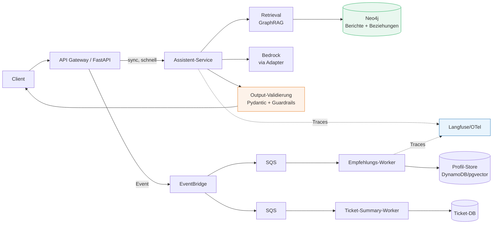

# Musterlösung 01 — AI-Ready-Assessment "TravelMate"

Keine "einzig richtige" Lösung — diese Fassung dient dem Vergleich in der Abschlussrunde.

## Teil 1 — Assessment

| Merkmal | Bewertung | Begründung |
|---|---|---|
| Ereignisorientiert | ⛔ | Alles synchron im Monolith; LLM-Call blockiert Request-Handler → Timeouts unter Last |
| Daten-zugänglich | 🟡 | Daten zentral in einer DB, aber falsch geschnitten: Reiseberichte als HTML-Blobs, Suche per `LIKE`, kein Zugriff pro Muster (Vektor/Graph) |
| Kontext-fähig | ⛔ | "Kontext" = 5 `LIKE`-Treffer; keine Embeddings, kein Retrieval-Konzept, keine Beziehungen (Kunde↔Buchung↔Ziel) |
| Nichtdeterminismus-fest | ⛔ | LLM-Output ungeprüft als HTML ausgegeben (auch ein Injection-/XSS-Risiko) |
| Beobachtbar | ⛔ | Keine Traces, Token- oder Kostenerfassung — die "überraschende Rechnung" ist das Symptom |
| Modell-austauschbar | ⛔ | OpenAI-Call hart im Request-Handler codiert |

## Teil 2 — Ziel-Architektur

**Zu den Leitfragen:**

1. **Sync vs. async:** Der Q&A-Assistent bleibt synchron (Nutzer wartet auf Antwort — aber mit Streaming und Timeout-Budget). Empfehlungen und Ticket-Zusammenfassungen sind asynchron: Sie haben keinen wartenden Nutzer, vertragen Verzögerung und profitieren von Retry/DLQ und Batch-Verarbeitung (Kosten).
2. **Datenablagen:** Reiseberichte → Neo4j als Knowledge Graph (Berichte, Ziele, Themen, Autoren + Vector Index für semantische Suche); Nutzerprofile/Empfehlungen → Key-Value (DynamoDB) oder pgvector-Tabelle für Ähnlichkeitssuche; bestehende relationale Daten bleiben in PostgreSQL.
3. **Guardrails:** (a) Output-Schema-Validierung (Pydantic) direkt nach jedem LLM-Call, (b) Content-Filter/Guardrail vor Auslieferung an den Client, (c) niemals LLM-Output als rohes HTML rendern.

## Teil 3 — Antwort an den CTO

"Nein — wir trainieren keine Modelle, wir konsumieren sie per API (Bedrock/OpenAI). Dafür brauchen wir kein Data-Science-Team und kein SageMaker, sondern Architektur-Arbeit: Events, Datenablagen für Retrieval, Validierung und Observability. Ein DS-Team würde erst relevant, wenn wir eigene Modelle feintunen oder klassische ML-Probleme (z. B. Preisprognosen) lösen wollen."

## Zusatzfrage

Ab Tag 1 mitloggen: Request-ID + eingesetztes Modell + Prompt-/Response-Tokens (Kosten), Latenz je LLM-Call, verwendeter Kontext (welche Dokumente/Chunks), Nutzer-Feedback-Signal (Klick auf Empfehlung, Daumen hoch/runter). Damit sind spätere Offline-Evals (Ragas) und A/B-Vergleiche überhaupt erst möglich — ohne diese Rohdaten ist Evaluation in Tag 3 blind.
