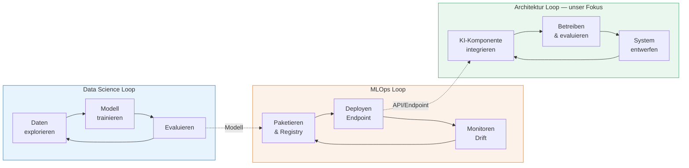
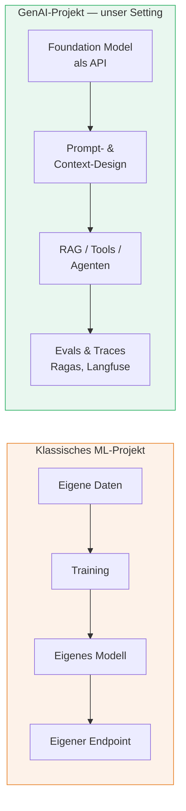
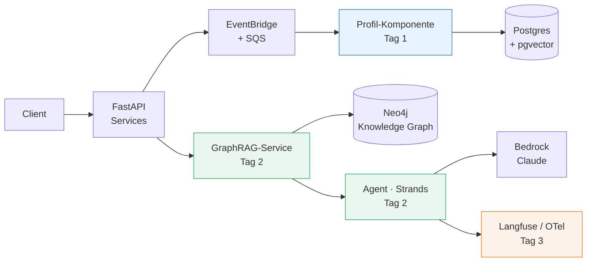

# Rolle der Softwarearchitektur in KI-Systemen

###### tag-1/01-architektur-fuer-ki · Tag 1 · Kapitel 01

Abgrenzung zu Data Science und MLOps

**Tag 1 · Kapitel 01** — Architecting AI-Ready Applications

<!--
Tag 1 · Kapitel 01 · Folie 1/10 (Titel)

Einstieg: Frage ins Publikum — "Wer hat schon eine KI-Komponente in Produktion? Wer hat schon mal ein Modell trainiert?" Meist: viele Erste, wenige Zweite. Genau diese Lücke ist das Thema der Schulung.
-->

---

# Worum es in dieser Schulung geht — und worum nicht

###### tag-1/01-architektur-fuer-ki · Tag 1 · Kapitel 01

| | Data Science | MLOps | **Diese Schulung: Architektur** |
|---|---|---|---|
| **Kernfrage** | Welches Modell löst das fachliche Problem? | Wie kommt ein Modell zuverlässig & wiederholbar in Produktion? | **Wie baue ich Systeme, die KI-Fähigkeiten sicher konsumieren?** |
| **Artefakt** | Modell, Notebook, Experiment | Pipeline, Registry, Endpoint | **Architektur: Services, Events, Datenflüsse, Verträge** |
| **Erfolgsmaß** | Modell-Metriken (F1, Loss) | Deploy-Frequenz, Drift erkannt | **Systemqualität: Korrektheit, Latenz, Kosten, Wartbarkeit** |
| **Zeithorizont** | Experiment (Tage–Wochen) | Modell-Lebenszyklus | **System-Lebenszyklus (Jahre)** |

 

> **These der Schulung:** Seit Foundation Models per API konsumierbar sind (Bedrock, OpenAI), ist die knappe Fähigkeit nicht mehr das Modelltraining — sondern **Software, die KI-ready ist**.

<!--
Tag 1 · Kapitel 01 · Folie 2/10 (Worum es geht — und worum nicht)

Das ist die Antwort auf die Agenda-Zeile "Abgrenzung zu Data Science und MLOps": Wir positionieren die Teilnehmer. Sie müssen kein Modell trainieren können — aber sie müssen die Schnittstellen zu DS/MLOps kennen und Systeme bauen, die Modelle als austauschbare Bausteine konsumieren.
-->

---

# Drei Disziplinen, drei Loops

###### tag-1/01-architektur-fuer-ki · Tag 1 · Kapitel 01

Die Loops laufen **unabhängig getaktet** — die Architektur muss Modellwechsel verkraften, ohne dass das System neu gebaut wird.

<!--
Tag 1 · Kapitel 01 · Folie 3/10 (Drei Disziplinen, drei Loops)

Freestyle-Punkt: An der gestrichelten Kante "API/Endpoint" aufhängen, dass der Architekt den Vertrag definiert (Latenz, Kosten, Schema), nicht das Modell-Innere. Beispiel: Modell-Upgrade Claude 3.5 → 4 sollte ein Config-Change sein, kein Refactoring.
-->

---

# Werkzeugkasten Data Science (zur Einordnung)

###### tag-1/01-architektur-fuer-ki · Tag 1 · Kapitel 01

| Zweck | Open Source | AWS-nativ |
|---|---|---|
| Exploration & Notebooks | [Jupyter](https://jupyter.org/), [pandas](https://pandas.pydata.org/), [Polars](https://pola.rs/) | [SageMaker Studio](https://docs.aws.amazon.com/sagemaker/latest/dg/studio.html) |
| Klassisches ML | [scikit-learn](https://scikit-learn.org/), [XGBoost](https://xgboost.readthedocs.io/) | [SageMaker Training Jobs](https://docs.aws.amazon.com/sagemaker/latest/dg/how-it-works-training.html) |
| Deep Learning | [PyTorch](https://pytorch.org/), [Hugging Face](https://huggingface.co/docs) | SageMaker + GPU-Instanzen |
| Experiment-Tracking | [MLflow Tracking](https://mlflow.org/docs/latest/ml/tracking/) | [SageMaker mit MLflow](https://docs.aws.amazon.com/sagemaker/latest/dg/mlflow.html) (managed) |

 

**Für Architekten relevant:** Diese Tools erzeugen *Artefakte* (Modelle, Datasets). Unsere Systeme müssen deren **Versionierung und Austauschbarkeit** respektieren — mehr nicht.

<!--
Tag 1 · Kapitel 01 · Folie 4/10 (Werkzeugkasten Data Science)

Nicht vertiefen — nur benennen, damit die Begriffe im Raum sind, wenn das DS-Team sie benutzt. MLflow taucht gleich bei MLOps wieder auf: Tracking ist DS-seitig, Registry/Serving ist Ops-seitig.
-->

---

# Werkzeugkasten MLOps (zur Einordnung)

###### tag-1/01-architektur-fuer-ki · Tag 1 · Kapitel 01

| Zweck | Open Source | AWS-nativ |
|---|---|---|
| Pipelines / Orchestrierung | [Kubeflow](https://www.kubeflow.org/), [Airflow](https://airflow.apache.org/), [Metaflow](https://metaflow.org/) | [SageMaker Pipelines](https://docs.aws.amazon.com/sagemaker/latest/dg/pipelines.html), [Step Functions](https://docs.aws.amazon.com/step-functions/) |
| Modell-Registry | [MLflow Model Registry](https://mlflow.org/docs/latest/ml/model-registry/) | [SageMaker Model Registry](https://docs.aws.amazon.com/sagemaker/latest/dg/model-registry.html) |
| Serving / Endpoints | [KServe](https://kserve.github.io/website/), [vLLM](https://docs.vllm.ai/), [Ray Serve](https://docs.ray.io/en/latest/serve/index.html) | [SageMaker Endpoints](https://docs.aws.amazon.com/sagemaker/latest/dg/realtime-endpoints.html), **[Bedrock](https://docs.aws.amazon.com/bedrock/) (fully managed)** |
| Monitoring / Drift | [Evidently](https://docs.evidentlyai.com/), MLflow | [SageMaker Model Monitor](https://docs.aws.amazon.com/sagemaker/latest/dg/model-monitor.html) |

 

**Die Abkürzung, die wir nehmen:** Mit **Bedrock** konsumieren wir Foundation Models als API — Training, Serving, Skalierung und GPU-Betrieb sind AWS' Problem, nicht unseres.

<!--
Tag 1 · Kapitel 01 · Folie 5/10 (Werkzeugkasten MLOps)

Wichtige Ehrlichkeit: SageMaker-Welt ist NICHT Thema der Schulung — sie zu kennen hilft aber, im Unternehmen die richtige Grenze zu ziehen. Wer eigene Modelle feintunen/hosten muss, landet bei SageMaker; wer konsumiert, bei Bedrock. Beides kann koexistieren.
-->

---

# GenAI verschiebt die Gewichte: von MLOps zu GenAIOps

###### tag-1/01-architektur-fuer-ki · Tag 1 · Kapitel 01

| MLOps-Frage | GenAIOps-Äquivalent |
|---|---|
| Trainings-Pipeline reproduzierbar? | **Prompt/Kontext versioniert?** |
| Modell-Metriken beim Training | **Evaluation im Betrieb** (Ragas, LLM-as-Judge) |
| Feature Store | **Context Engineering** (RAG, Memory, Tools) |
| Drift Detection | **Trace-Analyse** (OTel GenAI, Langfuse) |

<!--
Tag 1 · Kapitel 01 · Folie 6/10 (Von MLOps zu GenAIOps)

Hier die Beobachtung aus der Agenda-Diskussion ansprechen: Die Lernziele der Schulung KLINGEN nach Ops (Observability, Deployment, Kosten) — aber es ist Ops für KONSUMIERTE Modelle, nicht für trainierte. Das ist GenAIOps, und seine Werkzeuge (Tracing, Evals, Prompt-Versionierung) sind Architektur-Entscheidungen, keine Data-Science-Aufgaben. Deshalb gehört es in eine Architektur-Schulung.
-->

---

# Was macht eine Anwendung "AI-ready"?

###### tag-1/01-architektur-fuer-ki · Tag 1 · Kapitel 01

| Qualitätsmerkmal | Bedeutung | Tag |
|---|---|---|
| **Ereignisorientiert** | KI-Workloads sind langsam & teuer → asynchron entkoppeln (Queue, Retry, DLQ) | 1 |
| **Daten-zugänglich** | Kontext ist der Rohstoff: Daten pro Zugriffsmuster richtig ablegen (SQL, Vektor, Graph, KV) | 1–2 |
| **Kontext-fähig** | System kann relevantes Wissen zur Laufzeit bereitstellen (RAG/GraphRAG, Memory) | 2 |
| **Nichtdeterminismus-fest** | Ausgaben validieren (Pydantic), Guardrails, Fallbacks — LLM-Antwort ≠ Wahrheit | 2–3 |
| **Beobachtbar** | Jeder LLM-Call getract: Tokens, Latenz, Kosten, Qualität | 3 |
| **Modell-austauschbar** | Modell = Konfiguration, nicht Code; Provider-Wechsel ohne Redesign | 1–3 |

<!--
Tag 1 · Kapitel 01 · Folie 7/10 (AI-Ready-Merkmale)

Das ist die Brücke zur restlichen Schulung — jede Zeile wird zu einem Kapitel. Folie ruhig 2x zeigen: hier als Versprechen, am Ende von Tag 3 als Checkliste.
-->

---

# Zielbild der Schulung (entsteht in 3 Tagen)

###### tag-1/01-architektur-fuer-ki · Tag 1 · Kapitel 01

**Alles läuft zweimal:** lokal (Docker Compose + LocalStack) und in AWS (CDK) — mit demselben Code.

<!--
Tag 1 · Kapitel 01 · Folie 8/10 (Zielbild der Schulung)

Repo-Tour ankündigen (demo/): gleich zeigen, wo was liegt und wie jedes Kapitel aufgebaut ist (theorie/demo/uebung/loesung).
-->

---

# Verantwortlichkeits-Matrix (wer macht was?)

###### tag-1/01-architektur-fuer-ki · Tag 1 · Kapitel 01

| Aufgabe | Architekt | Data Scientist | MLOps/Platform |
|---|:---:|:---:|:---:|
| Modellwahl & -bewertung für den Use Case | ◑ | ● | |
| API-Verträge, Schemas, Fehlerverhalten | ● | | |
| Event-Design, Datenflüsse, Persistenz | ● | | ◑ |
| Prompt-/Context-Design | ◑ | ◑ | |
| Deployment-Pipeline, IaC | ◑ | | ● |
| Evaluation & Guardrails definieren | ● | ◑ | ◑ |
| Kosten-/Quota-Governance | ● | | ◑ |

● verantwortlich · ◑ beteiligt

**Grenzen dieser Schulung:** kein Modelltraining, kein Fine-Tuning, kein Feature Engineering, kein GPU-Sizing.

<!--
Tag 1 · Kapitel 01 · Folie 9/10 (Verantwortlichkeits-Matrix)

Diskussionsfolie — Zuordnung ist bewusst streitbar und je nach Org anders. 5 Minuten Meinungen einsammeln, das aktiviert den Raum vor der Übung.
-->

---

# Übung 01 — AI-Ready-Assessment

###### tag-1/01-architektur-fuer-ki · Tag 1 · Kapitel 01

**Aufgabe:** Ihr bekommt die Beschreibung einer bestehenden Anwendung (`uebung.md`).
Bewertet sie gegen die 6 AI-Ready-Merkmale und skizziert die Ziel-Architektur als Mermaid-Diagramm.

- Arbeitszeit: ~45 min in 2er/3er-Gruppen
- Ergebnis: ausgefüllte Assessment-Tabelle + ein Diagramm (max. 20 Nodes)
- Danach: 2 Gruppen präsentieren, Vergleich mit `loesung/`

<!--
Tag 1 · Kapitel 01 · Folie 10/10 (Übung 01)

Während der Übung: rumgehen, provozieren ("Warum ist der LLM-Call synchron im Checkout?"). Bei schnellen Gruppen die Zusatzfrage aus der Übung freigeben.
-->
