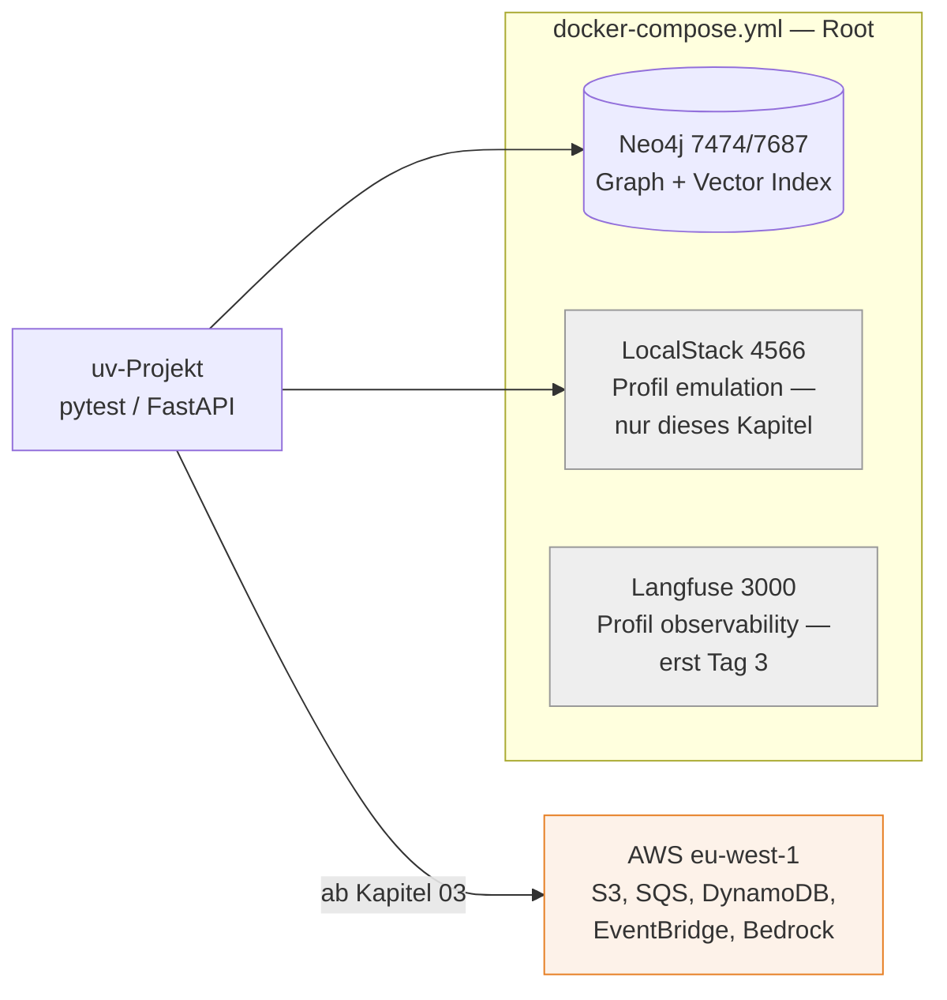

# Lokale Entwicklungsumgebung

###### tag-1/02-setup-lokal · Tag 1 · Kapitel 02

Ein Compose-File als "lokale Cloud"

**Tag 1 · Kapitel 02**

<!--
Tag 1 · Kapitel 02 · Folie 1/4 (Titel)

Kurz halten (10 min) — dieses Kapitel lebt von der Vorführung und der Praxis.
-->

---

# Werkzeuge & Prinzip

###### tag-1/02-setup-lokal · Tag 1 · Kapitel 02

| Werkzeug | Rolle | Warum |
|---|---|---|
| [uv](https://docs.astral.sh/uv/) | Python-Projekte & Dependencies | Ein Tool für venv/deps/run, lockfile-basiert, sehr schnell |
| [Docker Compose](https://docs.docker.com/compose/) | Alle lokalen Services | **Eine** Datei im Root, ein Befehl |
| [LocalStack](https://docs.localstack.cloud/) | AWS-API-Emulation | Gleicher boto3-Code lokal wie in AWS |
| [ruff](https://docs.astral.sh/ruff/) / [pyright](https://microsoft.github.io/pyright/) / [pytest](https://docs.pytest.org/) | Qualität | Lint+Format / Typen (strict) / Tests |

**Prinzip:** Lokal ≙ AWS. Der Code kennt nur Endpoints und Credentials aus der Konfiguration — nie hartcodierte Umgebungen.

<!--
Tag 1 · Kapitel 02 · Folie 2/4 (Werkzeuge & Prinzip)

Betonen: kein pip, kein poetry, kein conda in dieser Schulung. uv-Befehle, die heute ständig vorkommen: uv init, uv add, uv sync, uv run.
-->

---

# Der lokale Stack

###### tag-1/02-setup-lokal · Tag 1 · Kapitel 02



```bash
docker compose up -d                              # Kern: Neo4j
docker compose --profile emulation up -d          # + LocalStack (nur Kapitel 02)
docker compose --profile observability up -d      # + Langfuse (Tag 3)
```

**Kursentscheidung:** Ab Kapitel 03 läuft alles Weitere **direkt gegen AWS** — LocalStack lernt ihr heute als Option kennen, danach kein Umgebungs-Hin-und-Her mehr.

<!--
Tag 1 · Kapitel 02 · Folie 3/4 (Der lokale Stack)

Auf das Profil hinweisen — bewusste Entscheidung, damit Tag 1 nicht 10 Container zieht. Healthchecks zeigen: docker compose ps.
-->

---

# Was LocalStack kann — und was nicht

###### tag-1/02-setup-lokal · Tag 1 · Kapitel 02

**Einordnung:** LocalStack ist eine legitime Option für Offline-Entwicklung und CI — wir zeigen es genau **einmal** (heute) und arbeiten ab Kapitel 03 direkt gegen AWS, weil der Wechsel zwischen zwei Umgebungen mehr Komplexität kostet, als die Emulation spart.

**Funktioniert (Community-Edition, unser Umfang):** S3, SQS, SNS, EventBridge (Rules/Targets), DynamoDB, Lambda, SSM — die APIs verhalten sich für unsere Zwecke wie AWS.

**Geht nicht / anders:**

- **Kein Bedrock**: LLM-Aufrufe gehen immer gegen echtes AWS (Kapitel 03) — Emulation von Modellen wäre witzlos
- Kein IAM-Enforcement in der Community-Edition: lokal darf jeder alles — Rechte-Fehler seht ihr erst in AWS
- Einige Services nur in LocalStack Pro (z. B. RDS, ECS) — [Coverage-Liste](https://docs.localstack.cloud/references/coverage/)
- Persistenz über Neustarts nur in Pro — lokale Ressourcen sind flüchtig, Seed-Skripte gehören ins Projekt

**Konsequenz für die Architektur:** alles, was Ressourcen anlegt, muss idempotent und skriptbar sein — das zahlt direkt auf IaC (Kapitel 03) ein.

<!--
Tag 1 · Kapitel 02 · Folie 4/4 (LocalStack: was geht, was nicht)

Der Kontrast "lokal darf jeder alles vs. AWS enforced IAM" produziert morgen die ersten AccessDenied-Momente — jetzt ankündigen, dann ist der Frust geringer.
-->
