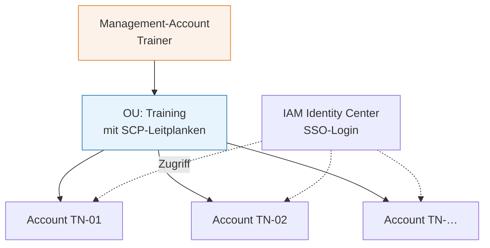
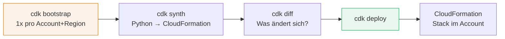

# AWS-Zugang & erster Deploy

###### tag-1/03-setup-aws · Tag 1 · Kapitel 03

Sub-Accounts, IAM Identity Center, CDK, Bedrock-Zugriff

**Tag 1 · Kapitel 03**

<!--
Tag 1 · Kapitel 03 · Folie 1/6 (Titel)

Während dieser Theorie laufen im Hintergrund bereits die Account-Erstellungen (trainer.md, Schritt 2) — die brauchen ein paar Minuten.
-->

---

# Account-Modell der Schulung

###### tag-1/03-setup-aws · Tag 1 · Kapitel 03



- **Ein Account pro Teilnehmer** = harte Isolation: niemand kann anderen etwas kaputt machen, Kosten sind pro Kopf sichtbar
- **SCPs** (Service Control Policies) auf der OU: nur `eu-west-1` (+ globale Services), keine teuren Instanztypen
- Genau so funktioniert es auch im Unternehmen: [AWS Organizations](https://docs.aws.amazon.com/organizations/latest/userguide/orgs_introduction.html) + [Landing-Zone-Konzepte](https://docs.aws.amazon.com/prescriptive-guidance/latest/migration-aws-environment/understanding-landing-zones.html)

<!--
Tag 1 · Kapitel 03 · Folie 2/6 (Account-Modell)

Architektur-Relevanz betonen: Account-Grenzen sind das gröbste und stärkste Isolationsmittel in AWS — auch für KI-Workloads (Kosten! Quotas!) ein legitimes Designelement.
-->

---

# Euer Zugang: IAM Identity Center (SSO)

###### tag-1/03-setup-aws · Tag 1 · Kapitel 03

1. Einladungs-Mail annehmen → Passwort + MFA setzen
2. **Access Portal** öffnen → euer Account mit Rolle `TrainingAdmin` erscheint
3. CLI koppeln:

```bash
aws configure sso          # SSO-Start-URL + Region vom Trainer
aws sso login --profile training
aws sts get-caller-identity --profile training   # Wer bin ich?
export AWS_PROFILE=training
```

**Kein** `aws_access_key_id` in Dateien — SSO-Tokens laufen ab, Access Keys leaken. ([Doku: aws configure sso](https://docs.aws.amazon.com/cli/latest/userguide/cli-configure-sso.html))

<!--
Tag 1 · Kapitel 03 · Folie 3/6 (Zugang via Identity Center)

Häufigster Fehler gleich vorwegnehmen: vergessenes AWS_PROFIL bzw. --profile → boto3 nimmt Default-Profil und schlägt fehl.
-->

---

# CDK-Workflow (heute bis "deploy")

###### tag-1/03-setup-aws · Tag 1 · Kapitel 03



- Stacks sind **Python-Klassen** (`infrastructure/stacks/`), Konstrukte in 3 Ebenen (L1 = rohes CloudFormation, L2 = kuratiert, L3 = Patterns)
- `cdk synth` läuft **offline** — CloudFormation-Template als Review-Artefakt
- Aufräumen ist erstklassig: `cdk destroy` (unsere Stacks setzen `RemovalPolicy.DESTROY`)

<!--
Tag 1 · Kapitel 03 · Folie 4/6 (CDK-Workflow)

Live zeigen, wie klein base_stack.py ist vs. wie viel CloudFormation synth erzeugt — das ist das L2-Argument.
-->

---

# Bedrock-Zugriff: zwei Stolpersteine

###### tag-1/03-setup-aws · Tag 1 · Kapitel 03

**1. Model Access** muss pro Account einmal aktiviert werden (Bedrock-Konsole → *Model access*). Das ist unsere **einzige** Console-Ausnahme — dafür gibt es kein stabiles CLI-API.

**2. Inference Profiles:** Viele Modelle sind in `eu-west-1` **nicht als On-Demand-Modell** aufrufbar, sondern über **EU-Cross-Region-Inference-Profile** (`eu.amazon.…`) — der Aufruf startet in Irland, kann aber in anderen EU-Regionen bedient werden.

```bash
aws bedrock list-foundation-models --region eu-west-1 \
  --query 'modelSummaries[?providerName==`Amazon`].modelId'
aws bedrock list-inference-profiles --region eu-west-1 \
  --query 'inferenceProfileSummaries[].inferenceProfileId'
```

**Merksatz:** Modell-ID ist Konfiguration (Env/SSM), niemals Code — Verfügbarkeit ändert sich schneller als eure Releases. ([Cross-Region Inference](https://docs.aws.amazon.com/bedrock/latest/userguide/cross-region-inference.html))

<!--
Tag 1 · Kapitel 03 · Folie 5/6 (Bedrock-Stolpersteine)

Datenschutz-Frage kommt garantiert: EU-Profile bleiben innerhalb EU-Regionen — für viele Compliance-Anforderungen der entscheidende Punkt. In der Übung finden die Teilnehmer ihre Profile selbst per CLI.
-->

---

# Kosten-Leitplanken (heute schon aktiv)

###### tag-1/03-setup-aws · Tag 1 · Kapitel 03

| Leitplanke | Mechanismus | Wirkung |
|---|---|---|
| Budget + Alarm | [AWS Budgets](https://docs.aws.amazon.com/cost-management/latest/userguide/budgets-managing-costs.html), 20 €/Account | Mail an Trainer bei 80 % |
| Regionen-Sperre | SCP auf der OU | Ressourcen nur in `eu-west-1` |
| Tagging | `project`/`owner`-Tags via CDK (`Tags.of(app)`) | Kosten pro Kapitel auswertbar |
| Wegwerf-Design | `RemovalPolicy.DESTROY`, `cdk destroy` | Kein Zombie-Stack nach der Schulung |

**Nicht abgedeckt:** Harte Ausgaben-*Stopps* gibt es in AWS nicht — Budgets alarmieren nur. Deshalb: Accounts nach der Schulung schließen (Trainer-Runbook).

<!--
Tag 1 · Kapitel 03 · Folie 6/6 (Kosten-Leitplanken)

Ehrlichkeit zahlt sich aus: "AWS kann Kosten nicht hart deckeln" überrascht viele Architekten — gutes Diskussionsthema für Tag 3 (FinOps).
-->
