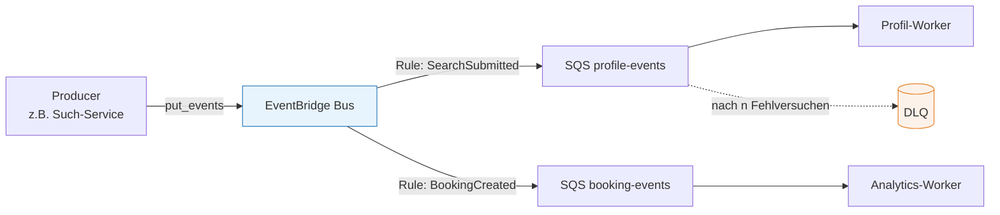
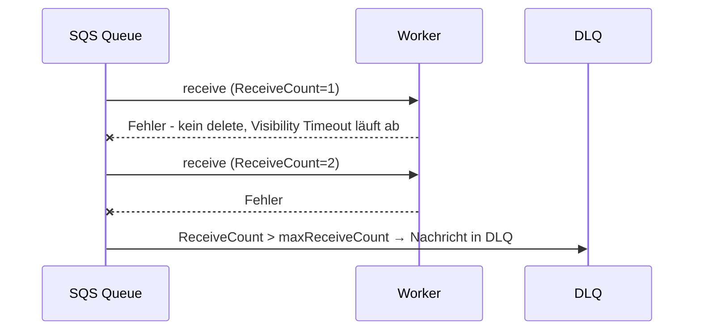

# Event-Driven Architecture für KI-Workloads

###### tag-1/04-event-driven-ki-workloads · Tag 1 · Kapitel 04

EventBridge, SQS, Retry, DLQ, Idempotenz

**Tag 1 · Kapitel 04**

<!--
Tag 1 · Kapitel 04 · Folie 1/6 (Titel)

Anknüpfen an Übung 01: Der TravelMate-Prototyp ist an synchronen LLM-Calls gestorben. Heute bauen wir das Rückgrat, das das verhindert.
-->

---

# Warum asynchron? KI-Workloads sind anders

###### tag-1/04-event-driven-ki-workloads · Tag 1 · Kapitel 04

| Eigenschaft von LLM-Calls | Konsequenz für die Architektur |
|---|---|
| **Langsam** (Sekunden, nicht Millisekunden) | Nutzer-Request nicht blockieren → Queue dazwischen |
| **Teuer** (pro Token bezahlt) | Peaks glätten (Load Leveling), Batching ermöglichen |
| **Fehleranfällig** (Throttling, Timeouts, Quotas) | Retry mit Backoff; nach n Versuchen → [DLQ](https://docs.aws.amazon.com/AWSSimpleQueueService/latest/SQSDeveloperGuide/sqs-dead-letter-queues.html) (Dead-Letter-Queue, Auffangqueue) |
| **Nichtdeterministisch** | Verarbeitung protokollieren, Ergebnis validieren |

**Faustregel:** synchron nur, wenn ein Mensch aktiv auf die Antwort wartet (Chat) — alles andere (Anreicherung, Zusammenfassung, Embeddings, Profile) läuft **event-getrieben im Hintergrund**.

<!--
Tag 1 · Kapitel 04 · Folie 2/6 (Warum asynchron)

Diskussionsfrage in den Raum: "Welche eurer geplanten KI-Features brauchen wirklich synchrone Antworten?" Meist bleibt nur Chat/Q&A übrig — der Rest ist Batch/Event.
-->

---

# Baustein-Wahl: EventBridge, SNS oder SQS?

###### tag-1/04-event-driven-ki-workloads · Tag 1 · Kapitel 04

| Baustein | Modell | Nimm es für … |
|---|---|---|
| [SQS](https://docs.aws.amazon.com/sqs/) (Simple Queue Service) | Queue (Pull, 1 Consumer-Gruppe) | Arbeit puffern, Retry/DLQ, genau **ein** Verarbeiter-Typ |
| [SNS](https://docs.aws.amazon.com/sns/) (Simple Notification Service) | Topic (Push, Fan-out) | Gleiches Signal an viele Abnehmer, auch E-Mail/SMS |
| [EventBridge](https://docs.aws.amazon.com/eventbridge/) | Event-Bus mit **Regeln & Filtern** | Domänen-Events routen: "wer sich interessiert, abonniert per Rule" |



**Unser Standard-Pattern:** EventBridge fürs Routing + SQS pro Consumer als Puffer (Rule → Queue → Worker).

<!--
Tag 1 · Kapitel 04 · Folie 3/6 (Baustein-Wahl)

Warum nicht Kafka? Legitime Frage — Antwort: gleiche Konzepte, anderes Betriebsmodell; EventBridge/SQS sind serverless und für die Schulung ohne Cluster-Betrieb. Wer Kafka im Haus hat, mappt die Patterns 1:1 (MSK erwähnen).
-->

---

# Zuverlässigkeit: Retry, DLQ, Idempotenz

###### tag-1/04-event-driven-ki-workloads · Tag 1 · Kapitel 04



- **Retry ist automatisch:** Nachricht wird nach Ablauf des [Visibility Timeout](https://docs.aws.amazon.com/AWSSimpleQueueService/latest/SQSDeveloperGuide/sqs-visibility-timeout.html) wieder sichtbar — Worker löscht erst **nach** Erfolg
- **DLQ** fängt Gift-Nachrichten: analysierbar statt endlos rotierend; Alarm auf DLQ-Tiefe gehört dazu
- **At-least-once** Zustellung heißt: Duplikate sind normal → Verarbeitung muss **idempotent** sein (Dedup-Key, Conditional Write — kommt in der Übung)

<!--
Tag 1 · Kapitel 04 · Folie 4/6 (Retry, DLQ, Idempotenz)

Betonen: "exactly once" gibt es nicht kostenlos — auch FIFO-Queues dedupen nur 5 Minuten. Idempotenz gehört in den Consumer, nicht in die Infrastruktur. Für KI doppelt wichtig: doppelte Verarbeitung = doppelte Tokens = doppelte Kosten.
-->

---

# Event-Design: Schema statt Bauchgefühl

###### tag-1/04-event-driven-ki-workloads · Tag 1 · Kapitel 04

```python
class SearchSubmitted(BaseModel):        # Pydantic v2 — validiert an der Grenze
    event_version: Literal["1"] = "1"    # Schema-Evolution von Tag 1 an
    event_id: UUID                       # Dedup-/Idempotenz-Schlüssel
    occurred_at: datetime
    user_id: str
    query: str                           # Nutzdaten: dünn halten
```

- **Dünne Events** (IDs + Minimum) statt fetter Payloads — Consumer holen Details selbst; wichtig, wenn Events später LLM-Kontext werden (Token-Kosten!)
- **EventBridge-Envelope**: `source` (wer), `detail-type` (was), `detail` (das Pydantic-JSON) — [Event-Struktur](https://docs.aws.amazon.com/eventbridge/latest/userguide/eb-events-structure.html)
- Ungültige Events **an der Grenze ablehnen** (Validation Error → DLQ), nie halb verarbeiten

<!--
Tag 1 · Kapitel 04 · Folie 5/6 (Event-Design)

Architektur-Punkt: Events sind öffentliche Verträge wie APIs — deshalb Versionsfeld ab dem ersten Tag. Kurz zeigen, wie das Pydantic-Modell in demo/models.py wiederauftaucht.
-->

---

# Lokal testen, in AWS betreiben

###### tag-1/04-event-driven-ki-workloads · Tag 1 · Kapitel 04

| Umgebung | Zweck | Aufruf |
|---|---|---|
| **AWS** (euer Account) | Primärweg ab jetzt — echtes IAM, echte Limits | `AWS_PROFILE=training uv run python …` |
| **LocalStack** | pytest-Substrat + Offline-Fallback | `AWS_ENDPOINT_URL=http://localhost:4566` |

- **Identischer Code** — nur die Endpoint-Konfiguration wechselt (`config.py`-Pattern aus Kapitel 02)
- In AWS zusätzlich real: **Queue-Policy** (EventBridge braucht Sendeerlaubnis auf die Queue!) — LocalStack erzwingt das nicht, AWS schon
- Demo: Pipeline Bus → Rule → Queue → Worker → DLQ komplett live

<!--
Tag 1 · Kapitel 04 · Folie 6/6 (Lokal vs. AWS)

Genau hier die LocalStack-Grundsatzfrage beantworten: LocalStack = Warm-up + Test-Substrat, AWS = Wahrheit. Die Queue-Policy ist das beste Beispiel — lokal läuft es auch ohne, in AWS nicht. Deshalb ab jetzt beides zeigen.
-->
