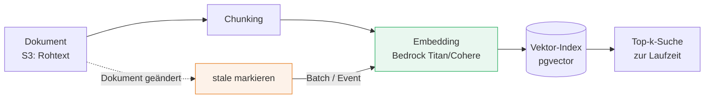
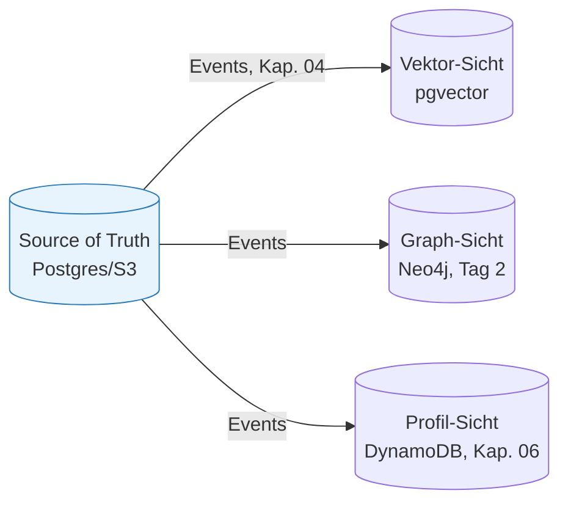

# Daten-zentrierte Architekturen & Persistenz

###### tag-1/05-daten-zentrierte-persistenz · Tag 1 · Kapitel 05

Zugriffsmuster, Embedding-Lifecycle, pgvector

**Tag 1 · Kapitel 05**

<!--
Tag 1 · Kapitel 05 · Folie 1/6 (Titel)

Roter Faden: In Kapitel 04 fließen Events — jetzt klären wir, WO die Daten landen, die daraus entstehen. "Daten-zentriert" heißt: Der Zugriffspfad der KI bestimmt die Ablage, nicht umgekehrt.
-->

---

# Zugriffsmuster bestimmen den Store

###### tag-1/05-daten-zentrierte-persistenz · Tag 1 · Kapitel 05

| Zugriffsmuster | Store-Typ | Lokal | AWS |
|---|---|---|---|
| Transaktionen, Joins, Reporting | Relational | [PostgreSQL](https://www.postgresql.org/docs/) | [Aurora/RDS](https://docs.aws.amazon.com/AmazonRDS/latest/AuroraUserGuide/) |
| Key-Lookup bei beliebiger Skala | Key-Value | DynamoDB (LocalStack) | [DynamoDB](https://docs.aws.amazon.com/dynamodb/) |
| Semantische Ähnlichkeit ("was passt dazu?") | Vektor-Index | [pgvector](https://github.com/pgvector/pgvector) | Aurora/RDS + pgvector |
| Beziehungen, Multi-Hop ("was hängt womit zusammen?") | Graph | [Neo4j](https://neo4j.com/docs/) | Neo4j auf EC2 (Tag 2) |
| Rohdaten, Dokumente, Modelle-Artefakte | Objekt | S3 (LocalStack) | [S3](https://docs.aws.amazon.com/s3/) |

**Anti-Pattern aus Übung 01:** alles in eine Tabelle, Suche per `LIKE` — die KI bekommt keinen brauchbaren Zugriffspfad.

<!--
Tag 1 · Kapitel 05 · Folie 2/6 (Zugriffsmuster → Store)

Merksatz anbieten: "Erst fragen, WIE gelesen wird — dann entscheiden, WO geschrieben wird." Ein Datum darf mehrfach materialisiert sein (S3-Rohtext + Vektor + Graph), solange klar ist, wer die Quelle ist → Folie 5.
-->

---

# Der Embedding-Lifecycle

###### tag-1/05-daten-zentrierte-persistenz · Tag 1 · Kapitel 05



- Embeddings sind **abgeleitete Daten** — jederzeit aus der Quelle reproduzierbar, aber **nicht kostenlos** (API-Kosten pro Token!)
- Änderung der Quelle ⇒ Embedding ist **stale**: markieren und **asynchron** neu berechnen (Event aus Kapitel 04), nicht synchron im Schreibpfad
- Modellwechsel (z. B. Titan v1 → v2) ⇒ **alle** Embeddings neu — Migrationspfad von Anfang an mitdenken; Modellname gehört als Spalte an jede Embedding-Zeile

<!--
Tag 1 · Kapitel 05 · Folie 3/6 (Embedding-Lifecycle)

Kostenrechnung an der Tafel: 40.000 Dokumente re-embedden bei Modellwechsel — was kostet das? Genau deshalb: Modellname als Spalte, Batch-Verarbeitung, stale-Flag statt sofortigem Re-Embed.
-->

---

# pgvector konkret

###### tag-1/05-daten-zentrierte-persistenz · Tag 1 · Kapitel 05

```sql
CREATE EXTENSION IF NOT EXISTS vector;
CREATE TABLE documents (id text PRIMARY KEY, title text,
                        embedding vector(1024), embedding_stale boolean);
CREATE INDEX ON documents USING hnsw (embedding vector_cosine_ops);
SELECT id, title FROM documents WHERE NOT embedding_stale
ORDER BY embedding <=> $1 LIMIT 5;   -- <=> Cosine, <-> L2, <#> Inner Product
```

| Index | Eigenschaft |
|---|---|
| **[HNSW](https://github.com/pgvector/pgvector#hnsw)** | Beste Query-Qualität/Geschwindigkeit; langsamerer Aufbau, mehr RAM — **unser Default** |
| **[IVFFlat](https://github.com/pgvector/pgvector#ivfflat)** | Schneller Aufbau; braucht `lists`-Tuning und gefüllte Tabelle |

**Grenzen:** Index maximal 2.000 Dimensionen (`vector`-Spalte selbst bis 16.000); ANN-Indexe sind **approximativ** — Recall < 100 % ist normal und konfigurierbar. Ohne Index: exakte Suche, aber sequentiell.

<!--
Tag 1 · Kapitel 05 · Folie 4/6 (pgvector konkret)

Wichtig gegen Halbwissen: kleiner Datenbestand ⇒ Postgres nutzt trotz Index einen Seq Scan — das ist korrektes Verhalten des Planners, kein Fehler. Kommt als Aha-Moment in der Übung (EXPLAIN).
-->

---

# Polyglot ja — aber mit einer Wahrheit

###### tag-1/05-daten-zentrierte-persistenz · Tag 1 · Kapitel 05



- **Eine** Quelle der Wahrheit; Vektor-, Graph- und Profil-Stores sind **abgeleitete Sichten** — neu aufbaubar, wegwerfbar
- Synchronisation über **Events** (Kapitel 04), nicht über Doppel-Schreiben im Request-Pfad ⇒ Konsistenz ist **eventual**: Sichten hinken Sekunden hinterher, das System muss das aushalten
- Jede Sicht beantwortet genau die Frage, für die sie gebaut ist — das ist der Kern von "daten-zentriert für KI"

<!--
Tag 1 · Kapitel 05 · Folie 5/6 (Polyglot mit einer Wahrheit)

Diskussionsfrage: "Was passiert, wenn jemand die Vektor-Sicht direkt beschreibt, ohne die Quelle zu ändern?" — Drift, nicht reproduzierbar. Deshalb: Sichten dürfen nur von der Pipeline beschrieben werden.
-->

---

# Demo & Übung: Mini-Dokument-Store

###### tag-1/05-daten-zentrierte-persistenz · Tag 1 · Kapitel 05

**Demo:** S3 (Rohtext) + Postgres (Metadaten + `vector`) — Ingest → Embedding → Top-k-Suche → Update markiert stale → Re-Embed.

**Bewusste Vereinfachung heute:** Embeddings kommen aus einer **deterministischen Fake-Funktion** (hash-basiert, 16 Dimensionen) — gleiche Pipeline, null API-Kosten, testbar ohne AWS. Morgen (Tag 2) wird nur diese eine Funktion gegen Bedrock-Embeddings getauscht.

**Übung:** Re-Embed **event-getrieben** (SQS aus Kapitel 04) + Beweis per `EXPLAIN`, dass euer HNSW-Index überhaupt benutzt wird.

<!--
Tag 1 · Kapitel 05 · Folie 6/6 (Demo & Übung)

Die Fake-Embedding-Entscheidung explizit begründen: Didaktik (Pipeline verstehen) + Kosten (keine Tokens für Spielereien) + Testbarkeit (deterministisch). Der Austauschpunkt ist eine einzige Funktion — das IST die Modell-Austauschbarkeit von Folie 7 aus Kapitel 01.
-->
