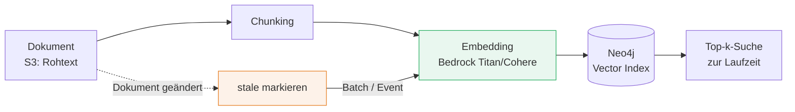
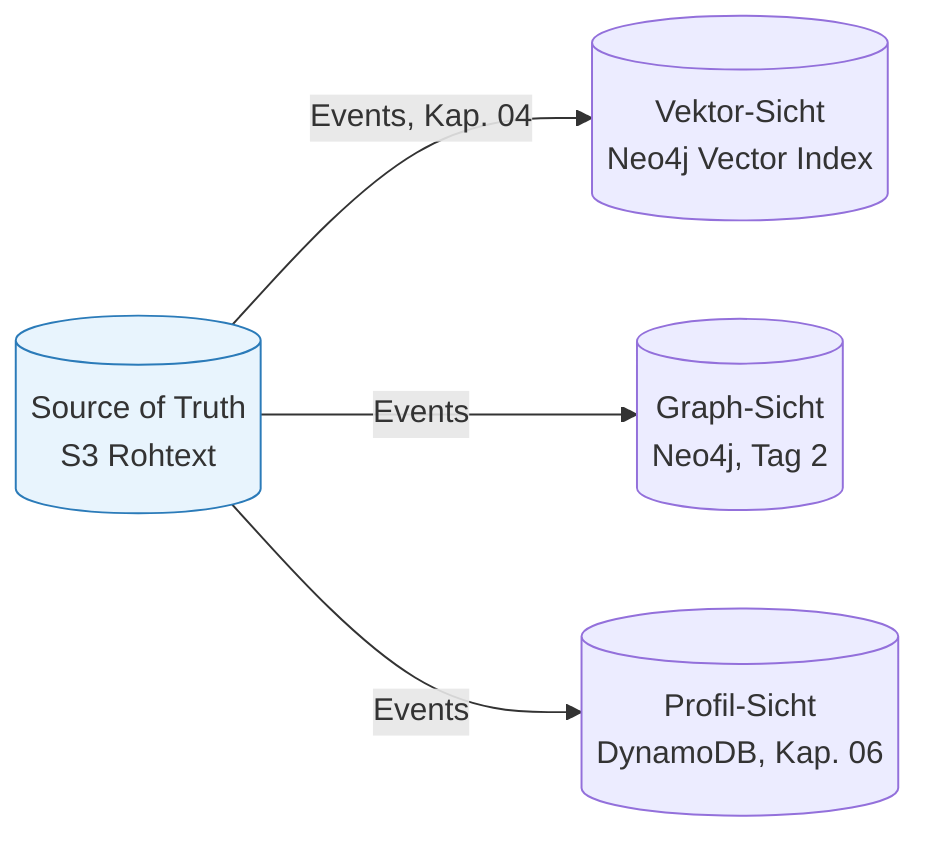

# Daten-zentrierte Architekturen & Persistenz

###### tag-1/05-daten-zentrierte-persistenz · Tag 1 · Kapitel 05

Zugriffsmuster, Embedding-Lifecycle, Neo4j Vector Index

**Tag 1 · Kapitel 05**

<!--
Tag 1 · Kapitel 05 · Folie 1/6 (Titel)

Roter Faden: In Kapitel 04 fließen Events — jetzt klären wir, WO die Daten landen, die daraus entstehen. "Daten-zentriert" heißt: Der Zugriffspfad der KI bestimmt die Ablage, nicht umgekehrt.
-->

---

# Zugriffsmuster bestimmen den Store

###### tag-1/05-daten-zentrierte-persistenz · Tag 1 · Kapitel 05

| Zugriffsmuster | Store-Typ | In dieser Schulung |
|---|---|---|
| Key-Lookup bei beliebiger Skala | Key-Value | [DynamoDB](https://docs.aws.amazon.com/dynamodb/) (AWS, on-demand) |
| Semantische Ähnlichkeit ("was passt dazu?") | Vektor-Index | [Neo4j Vector Index](https://neo4j.com/docs/cypher-manual/current/indexes/semantic-indexes/vector-indexes/) — dieselbe DB wie der Graph |
| Beziehungen, Multi-Hop ("was hängt womit zusammen?") | Graph | [Neo4j](https://neo4j.com/docs/) (lokal; auf EC2 ab Tag 2) |
| Rohdaten, Dokumente, Modell-Artefakte | Objekt | [S3](https://docs.aws.amazon.com/s3/) (AWS) |
| Transaktionen, Joins, Reporting | Relational | [Aurora/RDS](https://docs.aws.amazon.com/AmazonRDS/latest/AuroraUserGuide/) + [pgvector](https://github.com/pgvector/pgvector) — hier bewusst **nicht** im Einsatz |

- **Stack-Entscheidung:** Vektor + Graph in **einer** DB (Neo4j) statt zusätzlich Postgres/pgvector — weniger Tool-Vielfalt, und der GraphRAG-Vergleich an Tag 2 hat nur noch eine Variable: das Retrieval-Muster, nicht die Datenbank
- **Anti-Pattern aus Übung 01:** alles in eine Tabelle, Suche per `LIKE` — die KI bekommt keinen brauchbaren Zugriffspfad

<!--
Tag 1 · Kapitel 05 · Folie 2/6 (Zugriffsmuster → Store)

Merksatz anbieten: "Erst fragen, WIE gelesen wird — dann entscheiden, WO geschrieben wird." Ein Datum darf mehrfach materialisiert sein (S3-Rohtext + Vektor + Graph), solange klar ist, wer die Quelle ist → Folie 5.
-->

---

# Der Embedding-Lifecycle

###### tag-1/05-daten-zentrierte-persistenz · Tag 1 · Kapitel 05



- **Begriff `stale`** (dt. "veraltet"): Die Quelle in S3 wurde geändert, aber das Embedding in Neo4j ist noch der alte Stand — das Dokument darf bis zum Re-Embed nicht in Suchtreffern auftauchen.
- Embeddings sind **abgeleitete Daten** — jederzeit aus der Quelle reproduzierbar, aber **nicht kostenlos** (API-Kosten pro Token!)
- Änderung der Quelle ⇒ Embedding **stale** markieren und **asynchron** neu berechnen (Event aus Kapitel 04), nicht synchron im Schreibpfad
- Modellwechsel (z. B. Titan v1 → v2) ⇒ **alle** Embeddings neu — Migrationspfad von Anfang an mitdenken; Modellname gehört als Spalte an jede Embedding-Zeile

<!--
Tag 1 · Kapitel 05 · Folie 3/6 (Embedding-Lifecycle)

Kostenrechnung an der Tafel: 40.000 Dokumente re-embedden bei Modellwechsel — was kostet das? Genau deshalb: Modellname als Spalte, Batch-Verarbeitung, stale-Flag statt sofortigem Re-Embed.
-->

---

# Neo4j Vector Index konkret

###### tag-1/05-daten-zentrierte-persistenz · Tag 1 · Kapitel 05

```cypher
CREATE VECTOR INDEX document_embeddings IF NOT EXISTS
FOR (d:Document) ON (d.embedding)
OPTIONS {indexConfig: {`vector.dimensions`: 16,
                       `vector.similarity_function`: 'cosine'}};

CALL db.index.vector.queryNodes('document_embeddings', 5, $queryVector)
YIELD node, score RETURN node.id, node.title ORDER BY score DESC;
```

- **Top-k-Suche** (`queryNodes(index, k, vector)`): die `k` Knoten, deren Embeddings dem Query-Vektor am nächsten sind. Der Index nutzt eine vorab gebaute Nachbarschaftsstruktur (ANN, Approximate Nearest Neighbor) statt alle Vektoren durchzurechnen — schnell auch bei Millionen Knoten.
- **`score` ist Ähnlichkeit** (größer = besser) — kein Distanzoperator wie bei pgvector/SQL
- Index-Aufbau läuft **asynchron**: nach Schreib-Bursts `CALL db.awaitIndexes()`; `SHOW VECTOR INDEXES` zeigt `state` (`POPULATING` → `ONLINE`/`FAILED`) und `populationPercent` — Neo4j pflegt beides selbst
- Dimension und Similarity-Funktion (`cosine`/`euclidean`) sind **fix pro Index** — Modellwechsel mit anderer Dimension heißt: neuer Index (passt zur Lifecycle-Folie)
- ANN-Suche ist **approximativ** — Recall < 100 % ist normal; max. 4096 Dimensionen ([Doku](https://neo4j.com/docs/cypher-manual/current/indexes/semantic-indexes/vector-indexes/))

<!--
Tag 1 · Kapitel 05 · Folie 4/6 (Neo4j Vector Index konkret)

Trick der Demo hervorheben: stale markieren = embedding-Property entfernen → der Knoten fliegt automatisch aus dem Index, kein WHERE-Filter nötig. Das ist der Neo4j-Weg für "abgeleitete Sicht invalidieren". Alternative pgvector/Aurora kurz einordnen für SQL-lastige Teams.
-->

---

# Viele Stores, eine Source of Truth

###### tag-1/05-daten-zentrierte-persistenz · Tag 1 · Kapitel 05



- **Single Source of Truth**; Vektor-, Graph- und Profil-Stores sind **abgeleitete Sichten** — neu aufbaubar, wegwerfbar
- Synchronisation über **Events** (Kapitel 04), nicht über Doppel-Schreiben im Request-Pfad ⇒ Konsistenz ist **eventual**: Sichten hinken Sekunden hinterher, das System muss das aushalten
- Jede Sicht beantwortet genau die Frage, für die sie gebaut ist — das ist der Kern von "daten-zentriert für KI"

<!--
Tag 1 · Kapitel 05 · Folie 5/6 (Viele Stores, eine Source of Truth)

Diskussionsfrage: "Was passiert, wenn jemand die Vektor-Sicht direkt beschreibt, ohne die Quelle zu ändern?" — Drift, nicht reproduzierbar. Deshalb: Sichten dürfen nur von der Pipeline beschrieben werden.
-->

---

# Demo & Übung: Mini-Dokument-Store

###### tag-1/05-daten-zentrierte-persistenz · Tag 1 · Kapitel 05

**Demo:** S3 (Rohtext, euer AWS-Account) + Neo4j (Metadaten + Vector Index) — Ingest → Embedding → Top-k-Suche → Update markiert stale → Re-Embed.

**Bewusste Vereinfachung heute:** Embeddings kommen aus einer **deterministischen Fake-Funktion** (hash-basiert, 16 Dimensionen) — gleiche Pipeline, null Token-Kosten, deterministisch testbar. Morgen (Tag 2) wird nur diese eine Funktion gegen Bedrock-Embeddings getauscht.

**Übung:** Re-Embed **event-getrieben** (SQS aus Kapitel 04) + Beweis per `SHOW VECTOR INDEXES`, dass euer Index `ONLINE` ist und die Top-k-Antworten liefert.

<!--
Tag 1 · Kapitel 05 · Folie 6/6 (Demo & Übung)

Die Fake-Embedding-Entscheidung explizit begründen: Didaktik (Pipeline verstehen) + Kosten (keine Tokens für Spielereien) + Testbarkeit (deterministisch). Der Austauschpunkt ist eine einzige Funktion — das IST die Modell-Austauschbarkeit von Folie 7 aus Kapitel 01.
-->
