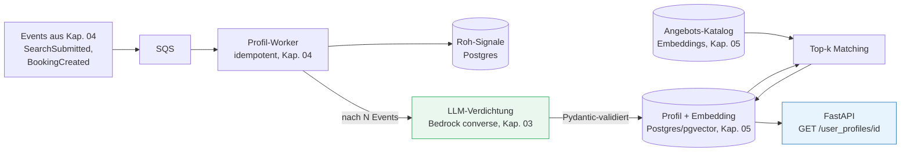

# Praxis: Die Benutzerprofil-Komponente

###### tag-1/06-praxis-benutzerprofil · Tag 1 · Kapitel 06

Alles aus Tag 1 wird **ein** lauffähiges System

**Tag 1 · Kapitel 06**

<!--
Tag 1 · Kapitel 06 · Folie 1/5 (Titel)

Rahmen setzen: Das ist das Praxisbeispiel aus der offiziellen Agenda ("event-getriebene Benutzerprofil-Komponente für KI-Personalisierung"). Kein neues Wissen — Kapitel 02 bis 05 werden zusammengesteckt.
-->

---

# Was die Komponente leistet

###### tag-1/06-praxis-benutzerprofil · Tag 1 · Kapitel 06

**Fachlich (TravelMate):** Jede Stelle im Portal — Startseite, Suche, Newsletter, morgen der Chat-Assistent — will wissen: *Wer ist dieser Nutzer und was interessiert ihn?*

```http
GET /user_profiles/{user_id}          → 200, immer schnell (< 50 ms)
{
  "user_id": "user-42",
  "interests": ["Strandurlaub", "Familienreisen"],
  "persona_summary": "Reist 2x im Jahr mit Kindern ans Meer, preisbewusst.",
  "recommendations": [{"id": "trip-7", "title": "Algarve mit Kindern"}],
  "profile_updated_at": "2026-07-06T09:15:00Z"
}
```

**Die eine Regel, an der alles hängt:** Im GET-Pfad wird **kein LLM aufgerufen**. Das Profil ist **vorberechnet** — die KI arbeitet vorher, event-getrieben, im Hintergrund.

<!--
Tag 1 · Kapitel 06 · Folie 2/5 (Was die Komponente leistet)

Kontrast zur Katastrophe aus Übung 01 ziehen: TravelMate rief das LLM synchron im Request auf. Unsere Komponente antwortet aus einer Tabelle — deshalb hält sie jede Last aus und kostet pro GET nichts.
-->

---

# Wo genau steckt GenAI drin? (3 Stellen)

###### tag-1/06-praxis-benutzerprofil · Tag 1 · Kapitel 06

| # | GenAI-Einsatz | Warum ein LLM (und nicht Code)? | Wann |
|---|---|---|---|
| 1 | **Interessen-Verdichtung:** Roh-Signale (Suchtexte, Buchungen) → strukturiertes Profil (`interests`, `persona_summary`) | Freitext-Suchen wie "warm im november nicht teuer mit kindern" versteht kein Regelwerk zuverlässig | Async, nach N neuen Events (Batching = Kostenkontrolle) |
| 2 | **Profil-Embedding:** Interessen-Text → Vektor → pgvector | Ähnlichkeit statt Gleichheit: "Strandurlaub" matcht "Küstenwanderung" | Direkt nach jeder Verdichtung |
| 3 | **Empfehlungen:** Top-k Angebote, deren Beschreibungs-Embeddings dem Profil-Vektor am nächsten sind (Kapitel-05-Store!) | Kein Kaltstart-Regelwerk; ein neues Angebot ist sofort empfehlbar | Beim Verdichten materialisiert |

**Anti-Pattern-Check:** LLM pro GET-Request (teuer, langsam), LLM entscheidet allein ohne Schema-Validierung, Empfehlungen live pro Request berechnen.

<!--
Tag 1 · Kapitel 06 · Folie 3/5 (Wo steckt GenAI drin)

Das beantwortet die Frage "wie passt GenAI in eine Profil-API": nicht IN der API, sondern in der Pipeline dahinter. Das LLM ist ein Batch-Verarbeiter mit Pydantic-Schema am Ausgang, kein Chat.
-->

---

# Architektur: alle Bausteine aus Tag 1

###### tag-1/06-praxis-benutzerprofil · Tag 1 · Kapitel 06



- Ausgabe des LLM wird **gegen ein Pydantic-Schema validiert**; ungültig ⇒ Retry, dann DLQ-Pfad — nie ungeprüft in die DB
- Verdichtung erst **ab Schwelle** (z. B. alle 5 Events): Kostenhebel Nummer 1

<!--
Tag 1 · Kapitel 06 · Folie 4/5 (Architektur)

Jede Box einem Kapitel zuordnen (steht dran) — die Teilnehmer sollen sehen, dass sie heute schon alles einmal gebaut haben. Neu ist nur FastAPI als dünne Leseschicht und der LLM-Batchschritt.
-->

---

# Ablauf der Übung (Rest des Tages)

###### tag-1/06-praxis-benutzerprofil · Tag 1 · Kapitel 06

| Etappe | Ergebnis | Baut auf |
|---|---|---|
| A | Events fließen: Producer → Queue → idempotenter Worker → Roh-Signale in Postgres | Kap. 04 |
| B | GET-API liefert Rohprofil (FastAPI, Pydantic-Response) | Kap. 02 |
| C | LLM-Verdichtung ab Event-Schwelle: Bedrock → validiertes Profil | Kap. 03 |
| D | Profil-Embedding + Top-k-Empfehlungen aus dem Angebots-Katalog | Kap. 05 |

- **A + B sind Pflicht**, C + D gestaffelt — wer C nicht erreicht, hat trotzdem eine lauffähige event-getriebene Komponente
- Abnahme je Etappe: ein pytest, der grün wird (steht in der Übung)

<!--
Tag 1 · Kapitel 06 · Folie 5/5 (Ablauf der Übung)

Zeitmanagement: A+B ~60 min, C ~45 min, D ~30 min. Bei C sammeln sich alle Bedrock-Probleme des Tages — Puffer einplanen. Abschlussrunde: Wer zeigt sein Profil-JSON?
-->
