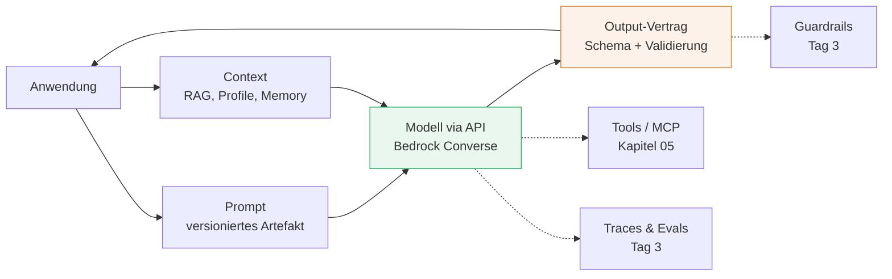
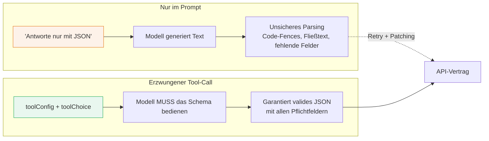

# Architektur von GenAI-Anwendungen

###### tag-2/01-genai-anwendungsarchitektur · Tag 2 · Kapitel 01

Bausteine, Modellwahl, strukturierte Outputs

**Tag 2 · Kapitel 01**

<!--
Tag 2 · Kapitel 01 · Folie 1/7 (Titel)

Rückblick Tag 1 in einem Satz: Events fließen, Daten liegen richtig, Bedrock ist erreichbar. Heute wird das LLM vom "hello world" zum Architektur-Baustein mit Vertrag.
-->

---

# Die Bausteine — jede Box ist eine Architektur-Entscheidung

###### tag-2/01-genai-anwendungsarchitektur · Tag 2 · Kapitel 01



**Kernidee:** Das Modell ist der am leichtesten austauschbare Baustein — Prompt, Context-Aufbau und Output-Vertrag sind euer eigentliches System.

<!--
Tag 2 · Kapitel 01 · Folie 2/7 (Bausteine)

An der Grafik entlang den Tag verkaufen: heute Modell+Prompt+Output-Vertrag (Kap. 01), Context kommt in 02/03 (RAG/GraphRAG), Tools in 05, Guardrails/Evals an Tag 3.
-->

---

# Modellwahl: Tiering statt "ein Modell für alles"

###### tag-2/01-genai-anwendungsarchitektur · Tag 2 · Kapitel 01

| Tier (Claude auf Bedrock) | Charakter | Typische Aufgaben |
|---|---|---|
| **Haiku** (`eu.anthropic.claude-haiku-4-5-…`) | schnell, billig | Klassifikation, Extraktion, Zusammenfassung, hohe Volumina |
| **Sonnet** (`eu.anthropic.claude-sonnet-4-6`, Sonnet 5) | ausgewogen | Q&A mit Kontext, Code, Agenten-Schritte |
| **Opus** (`eu.anthropic.claude-opus-4-8`) | maximale Qualität | komplexes Reasoning, heikle Texte — sparsam einsetzen |

- Preisunterschied zwischen Tiers: **Größenordnungen** ([Bedrock Pricing](https://aws.amazon.com/bedrock/pricing/)) — Architektur-Konsequenz: **Model-Router** pro Aufgabentyp (Übung!)
- IDs sind Config (Tag-1-Merksatz); in `eu-west-1` immer `eu.`-Inference-Profile; ältere Modelle werden als **Legacy** blockiert — Verfügbarkeit ändert sich unterm Jahr
- Weitere Dimensionen: Kontextfenster, Latenz, Datenregion (EU-Profile bleiben in der EU)

<!--
Tag 2 · Kapitel 01 · Folie 3/7 (Modellwahl)

Die Profile auf der Folie sind im Schulungskonto verifiziert (Juli 2026). Live zeigen: aws bedrock list-inference-profiles mit claude-Filter. Die Legacy-Falle aus der 03-Lösung erwähnen — genau so sehen echte Betriebsprobleme aus.
-->

---

# Prompt- & Context-Design

###### tag-2/01-genai-anwendungsarchitektur · Tag 2 · Kapitel 01

```python
SYSTEM_PROMPT_V3 = """Du bist Reise-Assistent von TravelMate.
Antworte auf Deutsch, maximal drei Sätze.
Nutze ausschließlich den bereitgestellten Kontext."""   # Rolle, Regeln, Grenzen

user_message = f"Kontext:\n{context}\n\nFrage: {question}"  # Daten, pro Request
```

- **System** = stabile Rolle + Regeln (versioniert wie Code: `_V3`); **User** = variable Daten. Nicht mischen.
- **Context-Budget:** jedes Token kostet Geld und Latenz — Kontext ist kuratiert (Top-k, Profile), nie "einfach alles rein"
- `inferenceConfig`: `temperature=0` für Extraktion/Klassifikation, `maxTokens` als Kosten-Airbag ([Parameter-Doku](https://docs.aws.amazon.com/bedrock/latest/userguide/inference-parameters.html))
- Prompts gehören ins Repo, nicht in Köpfe — Änderungen sind Deployments (Tag 3: Prompt-Versionierung in Langfuse)

<!--
Tag 2 · Kapitel 01 · Folie 4/7 (Prompt- & Context-Design)

Der _V3-Suffix ist der Aufhänger: "Wer von euch hat Prompts in Produktion, die nur in einem Slack-Thread dokumentiert sind?" Prompt-Reviews wie Code-Reviews.
-->

---

# Strukturierte Outputs: der Vertrag mit dem Modell

###### tag-2/01-genai-anwendungsarchitektur · Tag 2 · Kapitel 01

Zwei Wege, JSON aus dem Modell zu bekommen:

| Ansatz | Mechanik | Verlässlichkeit |
|---|---|---|
| "Antworte nur mit JSON …" | Prompt-Disziplin | fragil: ```json-Code-Fences, Fließtext drumherum, fehlende Felder |
| **Erzwungener Tool-Call** | `toolConfig` + [`toolChoice: {tool: …}`](https://docs.aws.amazon.com/bedrock/latest/userguide/tool-use.html) — Schema direkt aus `model_json_schema()` | Modell **muss** das Schema bedienen |

```python
tool = {"toolSpec": {"name": "record_profile", "inputSchema": {
        "json": TravelerProfile.model_json_schema()}}}
response = client.converse(..., toolConfig={
    "tools": [tool], "toolChoice": {"tool": {"name": "record_profile"}}})
profile = TravelerProfile.model_validate(tool_use_input)   # Pydantic bleibt Pflicht!
```

**Validieren trotzdem immer** — das Schema erzwingt Struktur, nicht Korrektheit. Ungültig ⇒ 1 Retry mit Fehlertext, dann Fehlerpfad (DLQ-Denke aus Tag 1).

<!--
Tag 2 · Kapitel 01 · Folie 5/7 (Strukturierte Outputs)

Das ist DIE Folie des Kapitels: LLM-Output wird erst durch Schema + Validierung + Retry-Politik zum API-Vertrag. In der Demo live zeigen, wie das toolUse-Input-Objekt aus der Response gefischt wird.
-->

---

# Warum erzwungener Tool-Call statt Prompt-Disziplin?

###### tag-2/01-genai-anwendungsarchitektur · Tag 2 · Kapitel 01



- **Das Modell führt euren Python-Code nicht aus.** Es erzeugt lediglich eine JSON-Antwort, die eurem Tool-Schema entspricht — euer eigener Code empfängt die JSON und validiert sie mit Pydantic.
- **API-Level-Schema ist Vertrag, Prompt ist Bittgesang.** Ein `toolChoice`-Zwang bindet das Modell auf API-Ebene an euer Schema; eine Prompt-Anweisung wie "respond in JSON" ist Best-Effort — das Modell kann trotzdem fehlerhafte JSON oder Erklärtext zurückgeben.
- **Kurzantwort auf "Warum nicht selbst mit LangChain/Prompt?"**: Tool-Calling liefert Schema-Enforcement auf API-Ebene (das Modell ist vertraglich verpflichtet, valides JSON in eurem Schema zu liefern), während Prompt-basierte Strukturierung ein Good-Faith-Versuch ist, der kaputte Responses erzeugen kann, die euer Parsing zerschießen.

<!--
Tag 2 · Kapitel 01 · Folie 5b/7 (Warum erzwungener Tool-Call)

Häufige Frage aus dem Publikum: "Warum brauche ich das, wenn ich auch einfach im Prompt sagen kann 'gib mir JSON'?" — Die Kernantwort: Es geht um Zuverlässigkeit. Tool-Call-Enforcement ist ein API-Vertrag, kein Höflichkeitsrequest. Wichtig: Das Modell führt euren Code nicht aus, es liefert nur JSON, die ihr dann selbst validiert.
-->

---

# Betrieb: Fehler und Kosten von Anfang an

###### tag-2/01-genai-anwendungsarchitektur · Tag 2 · Kapitel 01

| Realität | Architektur-Antwort |
|---|---|
| `ThrottlingException` bei Lastspitzen | Retry mit Backoff (boto3 macht Basis-Retries); besser: Queue davor (Kapitel 04!) |
| Läuft, aber langsam | Timeout-Budget pro Call; Streaming für Chat-UX (`converse_stream`) |
| Rechnung überrascht | `usage` aus **jeder** Response wegschreiben (Tokens rein/raus) — Grundlage für Tag-3-FinOps |
| Modell antwortet Unsinn | Output-Vertrag (Folie 5) + Evals (Tag 3) — niemals ungeprüft weiterreichen |

**Übung gleich:** Model-Router mit Kosten-Messung + eigener Output-Vertrag mit erzwungenem Tool-Call.

<!--
Tag 2 · Kapitel 01 · Folie 7/7 (Betrieb)

Brücke zu Tag 1 schlagen: Queue vor dem LLM = Kapitel 04, usage-Tracking = Vorarbeit für Langfuse an Tag 3. Danach direkt in die Demo.
-->
