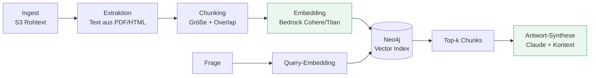
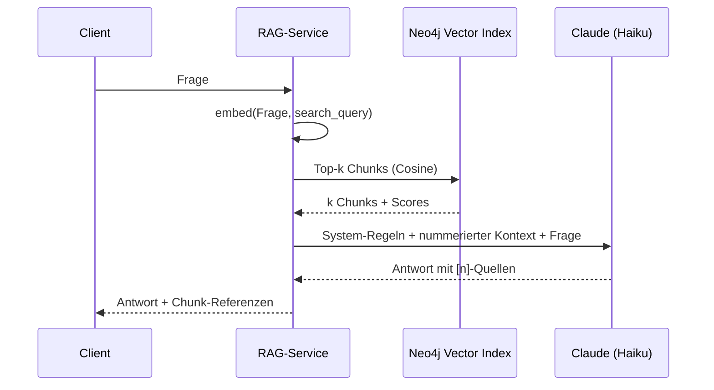

# Dokumentenpipeline & Embeddings

###### tag-2/02-dokumentenpipeline-embeddings · Tag 2 · Kapitel 02

Chunking, echte Embeddings, Vector-RAG als Baseline

**Tag 2 · Kapitel 02**

<!--
Tag 2 · Kapitel 02 · Folie 1/6 (Titel)

Anschluss an Tag 1: Der Kapitel-05-Store läuft schon mit Fake-Embeddings. Heute wird genau eine Funktion getauscht — und dann bauen wir den kompletten RAG-Query-Flow. Das ist die Baseline, die morgen GraphRAG schlagen muss.
-->

---

# Die Pipeline: jede Stufe eine eigene Fehlerquelle

###### tag-2/02-dokumentenpipeline-embeddings · Tag 2 · Kapitel 02

- Schlechte Antworten entstehen **selten beim Modell**, meist in Extraktion/Chunking/Retrieval — deshalb Stufe für Stufe messbar machen (Tag 3: Ragas)
- Ingest ist der Event-Flow aus Tag 1 (Kapitel 04/05: stale → re-embed) — heute konzentrieren wir uns auf Chunking → Retrieval → Antwort

<!--
Tag 2 · Kapitel 02 · Folie 2/6 (Pipeline)

Kriegsgeschichte erzählen: "RAG antwortet Unsinn" → in 8 von 10 Fällen findet das Retrieval den falschen Chunk oder die PDF-Extraktion hat Tabellen zerlegt. Das Modell ist der letzte Verdächtige, nicht der erste.
-->

---

# Chunking: die unterschätzte Design-Entscheidung

###### tag-2/02-dokumentenpipeline-embeddings · Tag 2 · Kapitel 02

| Strategie | Idee | Trade-off |
|---|---|---|
| **Fixe Größe + Overlap** | n Zeichen/Tokens, 10–20 % Überlappung | einfach, robust — unser Start |
| **Struktur-basiert** | an Absätzen/Überschriften schneiden | respektiert Sinneinheiten, braucht saubere Quellen |
| **Semantisch** | Schnitt bei Themenwechsel (Embedding-Distanz) | teurer Ingest, selten nötig |

- **Zu große Chunks:** Treffer enthalten viel Irrelevantes → verwässerter Kontext, mehr Tokens, schlechtere Antworten
- **Zu kleine Chunks:** Aussagen verlieren ihren Zusammenhang → Retrieval trifft, aber die Antwort hat keine Substanz
- Faustwert zum Start: **300–800 Tokens** pro Chunk, Overlap gegen zerschnittene Sätze — und dann **messen** statt glauben (Übung!)

<!--
Tag 2 · Kapitel 02 · Folie 3/6 (Chunking)

Betonen: Es gibt keinen universell richtigen Wert — deshalb macht die Übung ein echtes Chunking-Experiment mit Hit-Rate-Messung. Architekten sollen die Frage "welche Chunk-Größe?" mit "wie messt ihr das?" beantworten.
-->

---

# Embeddings auf Bedrock (verifiziert in eu-west-1)

###### tag-2/02-dokumentenpipeline-embeddings · Tag 2 · Kapitel 02

| | [Cohere Embed Multilingual v3](https://docs.aws.amazon.com/bedrock/latest/userguide/model-parameters-embed.html) | [Titan Text Embeddings V2](https://docs.aws.amazon.com/bedrock/latest/userguide/titan-embedding-models.html) |
|---|---|---|
| Dimensionen | 1024 | 256 / 512 / 1024 wählbar |
| Batch | bis 96 Texte pro Call | 1 Text pro Call |
| Besonderheit | `input_type`: `search_document` vs. `search_query` | `normalize`-Flag |
| Deutsch | **multilingual trainiert — unsere Wahl** | primär Englisch-optimiert |

- **`input_type` ist kein Detail:** Dokumente und Queries werden unterschiedlich eingebettet — falsch gemischt kostet Retrieval-Qualität
- Embeddings sind billig (Bruchteile eines Cents pro Dokument), aber **Re-Embed-Stürme** skalieren linear — Lifecycle aus Kapitel 05 gilt weiter
- API ist `invoke_model` mit Provider-spezifischem JSON-Body — nicht `converse`

<!--
Tag 2 · Kapitel 02 · Folie 4/6 (Embeddings auf Bedrock)

Beide Modelle sind im Schulungskonto live getestet. Falls jemand fragt: cohere.embed-v4 existiert dort auch (neuere Generation); wir bleiben bei v3 multilingual, weil input_type didaktisch wertvoll und die Doku stabil ist.
-->

---

# Der Query-Flow: Vector-RAG als Baseline

###### tag-2/02-dokumentenpipeline-embeddings · Tag 2 · Kapitel 02

- **Nummerierter Kontext** ⇒ zitierfähige Antworten (`[2]`) — Nachvollziehbarkeit ist Architektur, kein Nice-to-have
- Regel im System-Prompt: *nur aus dem Kontext antworten; wenn nichts passt, explizit sagen* — das Verhalten wird in der Übung getestet
- **Grenzen der Baseline** (Merken für Kapitel 03!): Multi-Hop-Fragen ("welche Ziele empfehlen Autoren, die auch X mögen?"), Aggregationen, explizite Beziehungen

<!--
Tag 2 · Kapitel 02 · Folie 5/6 (Query-Flow)

Die Grenzen-Bullets sind die Brücke zu GraphRAG morgen früh: Vector-RAG findet Ähnliches, aber keine Zusammenhänge. Diese Baseline wird in Tag 3 per Ragas gegen GraphRAG gemessen — deshalb bauen wir sie ordentlich.
-->

---

# Demo & Übung

###### tag-2/02-dokumentenpipeline-embeddings · Tag 2 · Kapitel 02

**Demo:** Kapitel-05-Store bekommt echte Embeddings — eine Funktion wird getauscht, der Rest bleibt. Dann: Chunking, Ingest von Reiseberichten, semantische Suche, die **ohne Wortüberlappung** trifft.

**Übung:**

1. Chunking-Experiment: zwei Konfigurationen, gemessen per **Hit-Rate@k** über einen Mini-Fragenkatalog
2. RAG-Antwort mit `[n]`-Zitaten und ehrlichem "steht nicht im Kontext"-Verhalten
3. Zusatz: `input_type` bewusst falsch verwenden und den Qualitätsverlust messen

**Kosten heute:** komplette Übung deutlich unter einem Cent — Embeddings sind der günstige Teil von GenAI.

<!--
Tag 2 · Kapitel 02 · Folie 6/6 (Demo & Übung)

Der Wow-Moment der Demo: Query "Urlaub am Wasser" findet den Algarve-Text, obwohl kein Wort übereinstimmt — das konnten die Fake-Embeddings aus Kapitel 05 nicht. Genau diesen Kontrast zeigen.
-->
