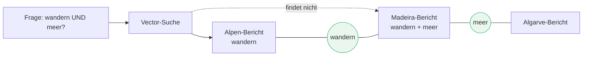
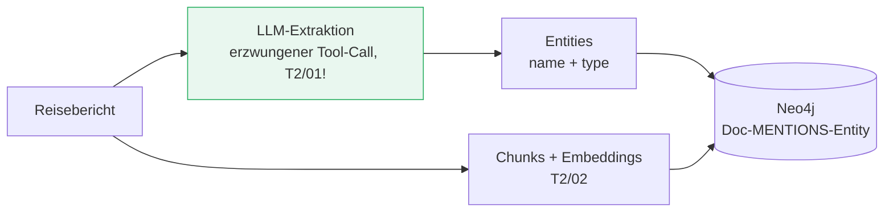
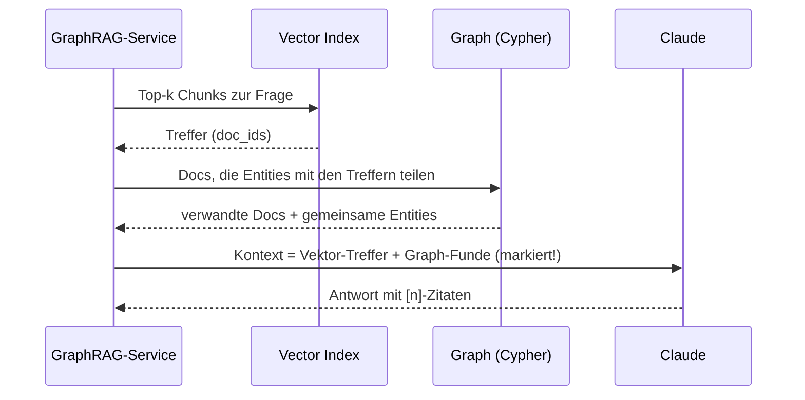

# GraphRAG

###### tag-2/03-graphrag · Tag 2 · Kapitel 03

Knowledge Graph + Vektor-Suche: Retrieval, das Zusammenhänge kennt

**Tag 2 · Kapitel 03**

<!--
Tag 2 · Kapitel 03 · Folie 1/6 (Titel)

Anknüpfen an die T2/02-Abschlussfrage: Jede Gruppe hat eine Frage formuliert, die Vector-RAG prinzipiell schlecht beantwortet. Genau die lösen wir jetzt.
-->

---

# Warum ein Graph? Die blinde Stelle der Vektor-Suche

###### tag-2/03-graphrag · Tag 2 · Kapitel 03

- Vector-Suche findet **Ähnliches zum Query** — sie sieht nicht, was Dokumente **untereinander** verbindet
- Typische Fragen, an denen die Baseline scheitert: Multi-Hop ("was passt zu Lesern von X?"), Aggregation ("welche Ziele decken A **und** B ab?"), explizite Beziehungen (Autor, Ort, Saison)
- **GraphRAG** = Vektor-Einstieg + Graph-Traversierung: erst ähnliche Chunks finden, dann über gemeinsame Entitäten zu verwandten Dokumenten laufen

<!--
Tag 2 · Kapitel 03 · Folie 2/6 (Warum Graph)

Das Diagramm ist der Kern des Kapitels: Die Kante über die gemeinsame Entität "wandern" existiert im Vektorraum nicht. GraphRAG macht implizites Wissen (geteilte Konzepte) zu expliziten, traversierbaren Kanten.
-->

---

# Knowledge-Graph-Konstruktion: das LLM als Extraktor

###### tag-2/03-graphrag · Tag 2 · Kapitel 03

- **Die Ontologie ist die harte Arbeit**, nicht der Code: Welche Entity-Typen? Welche Kanten? Wir starten bewusst klein: `destination`, `activity`, `audience` + eine Kante `MENTIONS`
- Extraktion nutzt den **Output-Vertrag aus T2/01** (Pydantic-Schema, erzwungener Tool-Call) — keine JSON-Fences, validiert, mit Retry
- `MERGE` statt `CREATE` bei Entitäten: "wandern" aus zwei Dokumenten muss **derselbe** Knoten werden — Normalisierung (Kleinschreibung, Grundform) gehört in den Prompt
- **Ehrlich:** Ingest kostet jetzt einen LLM-Call **pro Dokument**, und Dokument-Updates heißen Re-Extraktion + Graph-Abgleich — GraphRAG ist teurer als die Baseline

<!--
Tag 2 · Kapitel 03 · Folie 3/6 (KG-Konstruktion)

Diskussionspunkt Ontologie: zu fein (jedes Substantiv ein Knoten) = Rauschen; zu grob = keine Verbindungen. Die Teilnehmer erweitern die Ontologie in der Übung um einen Typ und spüren den Trade-off selbst.
-->

---

# Retrieval: Vektor-Einstieg + Graph-Expansion

###### tag-2/03-graphrag · Tag 2 · Kapitel 03

- Jeder Kontext-Chunk trägt seine **Herkunft** (`via: vector` / `via: graph:wandern`) — Nachvollziehbarkeit wie in T2/02, plus Erklärbarkeit *warum* ein Dokument dabei ist
- Die Expansion ist **eine Cypher-Query** — kein zweiter LLM-Call; Mehrkosten nur beim Ingest
- Weitere Muster (heute nicht gebaut): Community-Summaries für globale Fragen (Microsoft GraphRAG), Text2Cypher für Faktenfragen

<!--
Tag 2 · Kapitel 03 · Folie 4/6 (Retrieval)

Betonen: Der Unterschied zur Baseline ist EIN zusätzlicher Schritt zwischen Retrieval und Synthese. Deshalb war die T2/02-Architektur mit klaren Stufen so wichtig — GraphRAG ist ein Plug-in, kein Rewrite.
-->

---

# Ökosystem & unsere Wahl

###### tag-2/03-graphrag · Tag 2 · Kapitel 03

| Werkzeug | Ansatz | Einordnung |
|---|---|---|
| **Von Hand (heute)** | eigene Extraktion + Cypher | Volle Kontrolle, jedes Teil verstanden — genau richtig zum Lernen |
| [neo4j-graphrag](https://neo4j.com/docs/neo4j-graphrag-python/current/) | fertige KG-Pipeline + Retriever; **Bedrock-Adapter (LLM + Embeddings) eingebaut** (verifiziert, v1.18) | Produktions-Weg nach der Schulung — automatisiert, was wir heute von Hand bauen |
| [Microsoft GraphRAG](https://microsoft.github.io/graphrag/) | Communities + Summaries über den ganzen Korpus | Stark für globale Fragen; teuerster Ingest (viele LLM-Calls) |
| [LightRAG](https://github.com/HKUDS/LightRAG) | leichtgewichtige Graph+Vektor-Kombi | Forschungsnah, schnelle Experimente |
| [Bedrock KB GraphRAG](https://docs.aws.amazon.com/bedrock/latest/userguide/knowledge-base-build-graphs.html) | managed, auf Neptune Analytics | **Kostenfalle** für uns: Neptune-Analytics-Grundlast (Kosten-Radar!) |

**Messbar statt gefühlt:** Ob GraphRAG die Baseline wirklich schlägt, prüfen wir an Tag 3 mit [Ragas](https://docs.ragas.io/) — heute sammeln wir die Fragen dafür.

<!--
Tag 2 · Kapitel 03 · Folie 5/6 (Ökosystem)

Der neo4j-graphrag-Bedrock-Support wurde im Schulungs-Setup verifiziert (Adapter-Module vorhanden). Botschaft: erst das Muster verstehen (heute), dann die Bibliothek benutzen (im Projekt) — nie umgekehrt.
-->

---

# Demo & Übung

###### tag-2/03-graphrag · Tag 2 · Kapitel 03

**Demo:** 5 Reiseberichte → Entitäten-Extraktion per Tool-Call → Graph mit geteilten Entitäten → die Frage "wandern **und** Meer?", an der die Baseline vorbeigreift, bekommt Kontext aus mehreren Dokumenten — mit sichtbarer Herkunft pro Chunk.

**Übung:**

1. Eigenes Dokument einbringen + **Ontologie erweitern** (neuer Entity-Typ `season`) — was ändert sich an Prompt, Schema, Graph?
2. Baseline vs. GraphRAG **nebeneinander**: eure Multi-Hop-Frage aus T2/02 durch beide Pfade — welche Dokumente erreicht nur der Graph?
3. Zusatz: Graph-Exploration in Cypher ("welche Entities verbinden Doc A und B?")

**Kosten heute:** ~6 Extraktions-Calls + Embeddings + Antworten — weiterhin Centbereich, aber spürbar mehr Ingest-Aufwand als T2/02 (der Punkt ist Absicht).

<!--
Tag 2 · Kapitel 03 · Folie 6/6 (Demo & Übung)

Beim Vorführen die via-Spalte zeigen: "graph:wandern" erklärt dem Nutzer, WARUM der Madeira-Bericht im Kontext ist. Diese Erklärbarkeit ist ein unterschätztes GraphRAG-Argument gegenüber reiner Vektor-Suche.
-->
