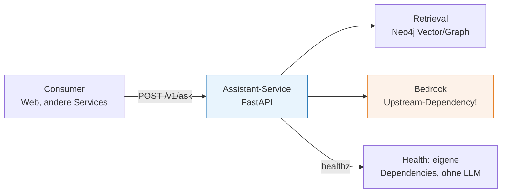
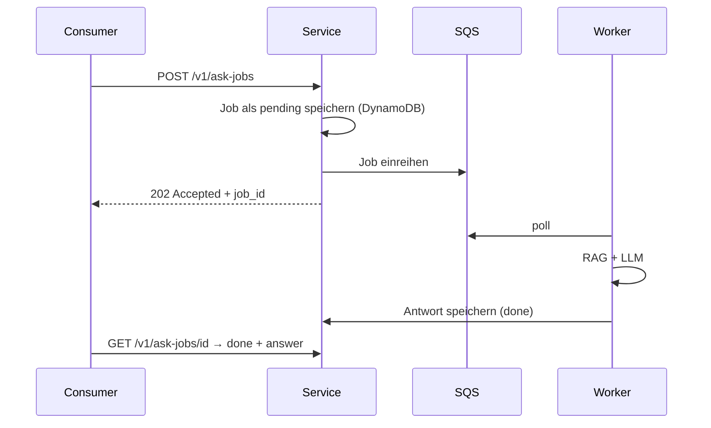

# KI-Services in Microservice-Landschaften

###### tag-2/04-ki-services-in-microservices · Tag 2 · Kapitel 04

Die KI-Fähigkeit wird ein ganz normaler Service — mit Vertrag, Fehlerbild und Grenzen

**Tag 2 · Kapitel 04**

<!--
Tag 2 · Kapitel 04 · Folie 1/6 (Titel)

Kernbotschaft vorwegnehmen: Nichts an diesem Kapitel ist KI-Magie. Es ist Microservice-Handwerk — nur dass die Upstream-Dependency ein LLM ist, das langsam, teuer und gelegentlich launisch ist.
-->

---

# Der KI-Service ist ein normaler Microservice

###### tag-2/04-ki-services-in-microservices · Tag 2 · Kapitel 04



- Das Modell läuft **nicht im Container** — es ist eine externe Dependency wie eine Datenbank: mit Latenz, Quotas und eigenen Fehlern
- Der Service kapselt Prompt, Retrieval und Modellwahl — **Konsumenten sehen nur den Vertrag**, nie das LLM
- `GET /healthz` prüft die **eigenen** Abhängigkeiten (Neo4j erreichbar?) und ruft **nie** das bezahlte Modell — Health-Checks laufen im Sekundentakt

<!--
Tag 2 · Kapitel 04 · Folie 2/6 (Normaler Microservice)

Die healthz-Regel provoziert gute Diskussionen: Ein Health-Check, der Bedrock aufruft, kostet bei 10s-Intervall echtes Geld und meldet Fehlalarm bei jedem Throttling. Eigene Dependencies ja, Upstream-LLM nein.
-->

---

# Der API-Vertrag: versioniert und ehrlich

###### tag-2/04-ki-services-in-microservices · Tag 2 · Kapitel 04

```json
POST /v1/ask  {"question": "Wo kann man mit Kindern baden?"}
→ 200 {"schema_version": "1", "request_id": "…", "answer": "… [1]",
       "refused": false, "sources": [{"doc_id": "algarve", "seq": 0}],
       "model_id": "eu.anthropic.claude-haiku-…",
       "input_tokens": 812, "output_tokens": 74, "latency_ms": 1430}
```

- **`sources` und `refused` gehören in den Vertrag** — Nachvollziehbarkeit ist Teil der API, nicht ein Log-Detail
- **Metriken pro Antwort** (Tokens, Latenz, Modell): Konsumenten und Betrieb sehen, was jeder Call kostet — Tag-3-Observability beginnt im Schema
- Eingaben validiert Pydantic (`min_length`, `max_length` — auch ein Kosten-Schutz!); Version im Schema, nicht nur in der URL

<!--
Tag 2 · Kapitel 04 · Folie 3/6 (API-Vertrag)

max_length=500 als Kostenschutz betonen: ohne Limit schickt ein Konsument versehentlich ein ganzes PDF als "question" — und bezahlt wird pro Token.
-->

---

# Fehlerbild: ehrlich statt heldenhaft

###### tag-2/04-ki-services-in-microservices · Tag 2 · Kapitel 04

| Upstream-Realität | Service-Antwort | Warum |
|---|---|---|
| `ThrottlingException` (Bedrock-Quota) | **503 + `Retry-After`** | Backpressure weitergeben — der Aufrufer entscheidet (Retry, Fallback, Queue) |
| Anderer Modell-Fehler | **502** | Upstream kaputt ≠ Service kaputt — sauber unterscheidbar |
| Kontext beantwortet Frage nicht | **200 + `refused: true`** | Fachlich gültiges Ergebnis, kein Fehler! |
| Frage zu kurz/lang | **422** | Vertragsverletzung des Aufrufers |

- **Niemals** eine erfundene Antwort als Fallback — lieber ein ehrlicher Fehlerstatus
- boto3 macht Basis-Retries selbst ([Doku](https://boto3.amazonaws.com/v1/documentation/api/latest/guide/retries.html)); der Service fügt **kein** eigenes Retry-Karussell davor (Latenz-Budget!)

<!--
Tag 2 · Kapitel 04 · Folie 4/6 (Fehlerbild)

Der Unterschied 503/502/200+refused ist DIE Prüfungsfrage des Kapitels. refused=true als Fehler zu modellieren ist der häufigste Designfehler: Monitoring zählt dann fachlich korrekte Antworten als Ausfälle.
-->

---

# Sync oder async? Beide — je nach Konsument

###### tag-2/04-ki-services-in-microservices · Tag 2 · Kapitel 04



| Muster | Wann |
|---|---|
| **Sync** `POST /v1/ask` | Nutzer wartet aktiv (Chat); Latenz-Budget einhaltbar |
| **Async** `ask-jobs` (202 + Polling) | Batch, teure Fragen, Lastspitzen — die Queue aus Kapitel 04/Tag 1 als Puffer |

**Reihenfolge zählt:** erst `pending` persistieren, **dann** einreihen — sonst fragt der Consumer nach einem Job, den es noch nicht gibt.

<!--
Tag 2 · Kapitel 04 · Folie 5/6 (Sync vs. async)

Brücke zu Tag 1: Das ist exakt die Kapitel-04-Queue, nur mit LLM-Worker. Wer dort die DLQ-Übung gemacht hat, weiß schon, was mit kaputten Jobs passiert.
-->

---

# Domänenmodell ↔ KI-Komponente + Demo/Übung

###### tag-2/04-ki-services-in-microservices · Tag 2 · Kapitel 04

- **LLM-Vokabular bleibt im Service:** Prompts, Modell-IDs, Token-Zahlen gehören nicht ins Domänenmodell der Konsumenten — der Vertrag übersetzt (`sources` statt "Chunks", `refused` statt Marker-String)
- Prompt = **versioniertes Artefakt im Service-Repo** (`SYSTEM_PROMPT_V1`), Modell-ID = Config — beides deploybar ohne Konsumenten-Release
- Wo der Service in der Landschaft steht: hinter dem API-Gateway wie jeder andere — Service-Mesh/AuthN/Rate-Limits gelten unverändert

**Demo:** Assistant-Service über der T2/02-Baseline — Vertrag, healthz, Throttling→503 (getestet ohne echtes Throttling: monkeypatch).
**Übung:** Ihr baut den Service um **euer** Retrieval und ergänzt den **Async-Pfad** (SQS + Worker + Status-Endpoint).

<!--
Tag 2 · Kapitel 04 · Folie 6/6 (Domänenmodell + Ausblick)

Ausblick auf Kapitel 05: Der Agent wird diesen Service als Tool aufrufen — genau deshalb war der saubere Vertrag heute wichtig. Ein Agent kann mit 503+Retry-After umgehen, mit einem erfundenen Fallback-Text nicht.
-->
