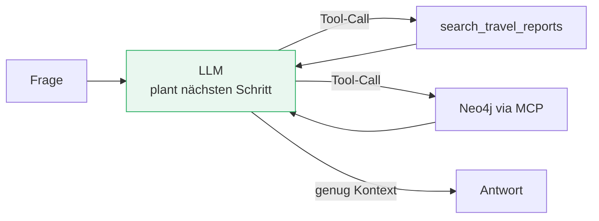

# Agenten & Orchestrierung

###### tag-2/05-agenten-orchestrierung · Tag 2 · Kapitel 05

Das Modell entscheidet, welche Tools es braucht — Strands Agents + MCP

**Tag 2 · Kapitel 05**

<!--
Tag 2 · Kapitel 05 · Folie 1/6 (Titel)

Bogen des Tages schließen: T2/01 Output-Verträge, T2/02-03 Retrieval, T2/04 Service — jetzt dreht sich die Kontrolle um: Bisher rief UNSER Code das LLM; ab jetzt entscheidet das LLM, welchen Code es ruft.
-->

---

# Was ein Agent ist — und was nicht

###### tag-2/05-agenten-orchestrierung · Tag 2 · Kapitel 05



- **Agent = Modell + Tools + System-Prompt in einer Schleife**: Das LLM entscheidet pro Runde, ob es ein Tool ruft oder antwortet ([Strands: model-driven](https://strandsagents.com/docs/))
- Der Unterschied zu T2/01–04: Dort war der Ablauf **fest programmiert** (erst Retrieval, dann Antwort) — hier wählt das Modell den Ablauf selbst
- Kein Agent nötig, wenn der Ablauf immer gleich ist! RAG-Pipeline (T2/02) bleibt die richtige Wahl für "Frage rein → Antwort raus" — Agenten lohnen sich bei **variablen** Wegen

<!--
Tag 2 · Kapitel 05 · Folie 2/6 (Was ein Agent ist)

Anti-Hype-Punkt zuerst: Die RAG-Baseline aus T2/02 ist KEIN Agent und soll auch keiner werden. Agent-Overhead (mehr Calls, weniger Determinismus) muss durch variable Aufgabenwege gerechtfertigt sein.
-->

---

# Strands Agents: Agent in wenigen Zeilen

###### tag-2/05-agenten-orchestrierung · Tag 2 · Kapitel 05

```python
from strands import Agent, tool
from strands.models import BedrockModel

@tool
def search_travel_reports(question: str) -> str:
    """Semantische Suche in den TravelMate-Reiseberichten."""   # der Docstring
    return format_hits(search(question, k=3))                    # IST die Tool-Doku!

agent = Agent(
    model=BedrockModel(boto_session=session, model_id=MODEL_ID, temperature=0.0),
    tools=[search_travel_reports],
    system_prompt=SYSTEM_PROMPT_V1,
)
result = agent("Wohin für eine Hüttentour?")
result.metrics.tool_metrics       # welche Tools liefen — beweisbar, testbar!
```

- [Strands](https://strandsagents.com/docs/) ist model-driven: keine Graphen verdrahten, das Modell führt die Schleife — [AWS-eigenes SDK](https://github.com/strands-agents/harness-sdk), produktiv u. a. in Amazon Q Developer
- **Docstring + Typen = Tool-Vertrag**: Davon hängt ab, ob das Modell das Tool richtig benutzt — Tool-Beschreibungen sind Prompt-Engineering
- `result.metrics`: Tool-Nutzung + Token-Verbrauch pro Lauf — unsere Tests **beweisen** Tool-Einsatz statt ihn zu vermuten

<!--
Tag 2 · Kapitel 05 · Folie 3/6 (Strands)

Live-Vergleich zu LangGraph ziehen (eine Folie Rückblick T2-README): Strands = Modell entscheidet; LangGraph = expliziter Graph, wenn deterministische Kontrolle Pflicht ist. Beide legitim — Auswahlkriterium ist, wer den Kontrollfluss besitzen soll.
-->

---

# MCP: Tools als Standard statt Eigenbau

###### tag-2/05-agenten-orchestrierung · Tag 2 · Kapitel 05

```python
from mcp import StdioServerParameters, stdio_client
from strands.tools.mcp import MCPClient

neo4j_mcp = MCPClient(lambda: stdio_client(StdioServerParameters(
    command="uvx", args=["mcp-neo4j-cypher"], env={...})))
with neo4j_mcp:                                    # Session offen halten!
    agent = Agent(model=model,
                  tools=[*own_tools, *neo4j_mcp.list_tools_sync()])
```

- **[MCP](https://modelcontextprotocol.io/)** (Model Context Protocol): offener Standard, wie Tools sich LLMs beschreiben — ein Server, jeder MCP-fähige Agent kann ihn nutzen
- Der [offizielle Neo4j-MCP-Server](https://neo4j.com/docs/mcp/current/) gibt dem Agenten Schema-Zugriff + Cypher: **der Agent schreibt seine Datenbank-Queries selbst** (Übung!)
- Grenze ehrlich benannt: MCP-Tools sind so sicher wie ihr Server — dem Agenten **nur Lese-Zugänge** geben; Schreibrechte sind eine Architektur-Entscheidung, kein Default

<!--
Tag 2 · Kapitel 05 · Folie 4/6 (MCP)

Der Aha-Moment der Übung: Niemand hat dem Agenten Cypher beigebracht — er holt das Schema über den MCP-Server und formuliert die Query selbst. Danach sofort die Sicherheitsfrage stellen: Wer will das mit Schreibrechten in Produktion? (Niemand.)
-->

---

# Orchestrierung: Ein Agent, viele Agenten, oder doch ein Workflow?

###### tag-2/05-agenten-orchestrierung · Tag 2 · Kapitel 05

| Muster | Wann | Beispiel |
|---|---|---|
| **Fester Ablauf** (kein Agent) | Weg ist immer gleich | RAG-Pipeline T2/02 |
| **Single Agent + Tools** | variable Wege, EIN Verantwortungsbereich | unsere Demo |
| **Multi-Agent** (Agent als Tool / [Strands-Muster](https://strandsagents.com/docs/)) | klar trennbare Spezialgebiete | Recherche-Agent + Buchungs-Agent |
| **Workflow-Engine** ([Step Functions](https://docs.aws.amazon.com/step-functions/)) | Determinismus/Audit Pflicht, LLM nur einzelne Schritte | Genehmigungsprozesse |

- **Agenda-Frage "Service-Mesh vs. Orchestrierungs-Framework":** Das Mesh (Netzwerk-Ebene: Routing, mTLS, Retries) bleibt zuständig — Agent-Orchestrierung ist **Anwendungs-Ebene**. Kein Entweder-oder, verschiedene Schichten
- Betriebskosten steigen mit jeder Agenten-Runde (jeder Schritt = LLM-Call) — `metrics.accumulated_usage` im Blick behalten; Deployment/Observability: Tag 3 (AgentCore)

<!--
Tag 2 · Kapitel 05 · Folie 5/6 (Orchestrierung)

Die Mesh-Frage kommt aus der offiziellen Agenda — Antwort: unterschiedliche Schichten. Istio sieht HTTP-Calls zwischen Services; wer welchen Agenten-Schritt WARUM macht, ist Anwendungslogik. Beides existiert parallel.
-->

---

# Demo & Übung

###### tag-2/05-agenten-orchestrierung · Tag 2 · Kapitel 05

**Demo:** Agent mit zwei Python-Tools über den Reiseberichten — `result.metrics` beweist, welches Tool das Modell wann gewählt hat.

**Übung:**

1. Eigenes Tool schreiben (Docstring = Vertrag!) und erleben, wie die Tool-Beschreibung die Modell-Wahl steuert
2. **MCP:** offiziellen Neo4j-Server anbinden — der Agent beantwortet Struktur-Fragen mit selbst geschriebenem Cypher
3. Zusatz: Agent-as-Tool (ein Spezialist als Werkzeug eines Generalisten)

**Kosten:** Jede Agenten-Runde ist ein LLM-Call — die Übung bleibt im Centbereich, aber der Multiplikator ist der Punkt.

<!--
Tag 2 · Kapitel 05 · Folie 6/6 (Demo & Übung)

Tagesabschluss nach der Übung: Die komplette T2-Kette einmal durchzeigen — Output-Vertrag → Embeddings → GraphRAG → Service → Agent. Morgen wird genau diese Kette beobachtbar, evaluierbar und deploybar gemacht.
-->
