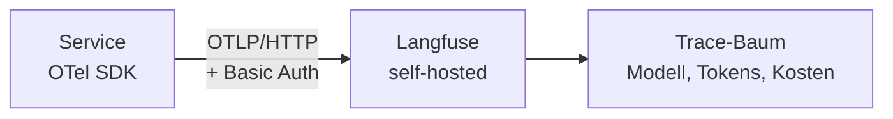

# Observability für KI-Komponenten

###### tag-3/01-observability · Tag 3 · Kapitel 01

Aus dem `print`-Rohstoff aus Tag 2 wird eine echte Trace

**Tag 3 · Kapitel 01**

<!--
Tag 3 · Kapitel 01 · Folie 1/7 (Titel)

Einstieg: Den T2/04-Service noch mal aufrufen und an die eine print-Zeile erinnern ("request_id=… model=… tokens=… latency_ms=…"). Heute wird genau diese Information zu einer durchsuchbaren, verschachtelten Trace — kein neues Konzept, nur die richtige Form.
-->

---

# Warum GenAI-Observability anders ist

###### tag-3/01-observability · Tag 3 · Kapitel 01

| Klassisches Logging | GenAI-Betrieb |
|---|---|
| Ein Request → ein Log-Eintrag | Ein Request → **mehrere** Schritte (Retrieval, LLM-Call, ggf. Tool-Calls) |
| Fehler = Exception | "Fehler" kann auch eine **fachlich korrekte, aber schlechte** Antwort sein |
| Kosten = Infrastruktur | Kosten = **pro Token**, unterschiedlich pro Modell und Aufruf |
| Determinismus: gleicher Input → gleicher Log | Nichtdeterminismus: gleiche Frage → andere Antwort, andere Tokenzahl |

- T2/04 hatte schon die richtigen Zahlen (Tokens, Latenz, Modell) — nur als **eine flache Zeile**, nicht als **Baum**
- T2/05 hatte schon `result.metrics.tool_metrics` — nur **im Prozess**, nicht durchsuchbar, nicht über Zeit vergleichbar
- Heute: dieselben Daten, aber als **Trace** — mit Eltern-Kind-Beziehung zwischen den Schritten

<!--
Tag 3 · Kapitel 01 · Folie 2/7 (Warum anders)

Kernbotschaft: keine neue Disziplin, sondern die fehlende Form für Daten, die bereits erzeugt wurden. Das nimmt der Folie die Schwere — Observability ist kein Extra-Aufwand, sondern Aufräumen.
-->

---

# OpenTelemetry GenAI Semantic Conventions

###### tag-3/01-observability · Tag 3 · Kapitel 01

```python
with tracer.start_as_current_span("rag.answer") as span:
    span.set_attribute("gen_ai.system", "aws.bedrock")
    span.set_attribute("gen_ai.request.model", model_id)
    span.set_attribute("gen_ai.usage.input_tokens", usage["inputTokens"])
    span.set_attribute("gen_ai.usage.output_tokens", usage["outputTokens"])
```

- **OpenTelemetry (OTel)** = offener Standard für Telemetrie; die [GenAI Semantic Conventions](https://opentelemetry.io/docs/specs/semconv/gen-ai/) geben standardisierte Attributnamen für LLM-Aufrufe vor — **Status: experimental**, Namen können sich noch ändern
- Kernattribute: `gen_ai.system` (Anbieter), `gen_ai.request.model`, `gen_ai.usage.input_tokens`/`output_tokens`, `gen_ai.operation.name`
- Der Sinn: **ein** Vokabular, das jedes OTel-fähige Backend versteht — kein proprietäres SDK für jedes Tool

<!--
Tag 3 · Kapitel 01 · Folie 3/7 (OTel GenAI Conventions)

Experimental-Status ehrlich benennen: die Attributnamen sind noch in Bewegung. Trotzdem sinnvoll, sie zu nutzen — Alternative wäre proprietäres Vokabular, das noch weniger stabil ist.
-->

---

# Langfuse als OTLP-Backend — was automatisch passiert

###### tag-3/01-observability · Tag 3 · Kapitel 01



**OTLP** (OpenTelemetry Protocol) = das Transportformat, über das ein OTel-SDK seine Traces an ein Backend schickt; Langfuse nimmt es direkt an.

**Verifiziert gegen die lokale Langfuse-Instanz:**

| Span-Attribut | Wirkung in Langfuse |
|---|---|
| `gen_ai.request.model` gesetzt | Observation wird automatisch als **GENERATION** klassifiziert |
| `gen_ai.usage.input_tokens`/`output_tokens` | füllt `usageDetails` (Tokens) — **Kosten** nur, wenn für die Modell-ID ein Preis hinterlegt ist |
| `gen_ai.prompt` / `gen_ai.completion` | Trace-Input/-Output |

**Kosten-Falle bei Cross-Region-Profilen:** Langfuses eingebaute Preistabelle matcht die `eu.`-Präfix-IDs (`eu.amazon.nova-lite-v1:0`) nicht automatisch ([Issue #6655](https://github.com/langfuse/langfuse/issues/6655)) — Preis einmalig als eigene Model-Definition hinterlegen (Project Settings → Models), dann füllt Langfuse die Kostenspalte selbst.

**Endpoint:** `POST {host}/api/public/otel/v1/traces`, Basic-Auth mit `public_key:secret_key` — kein SDK-Zwang, jedes OTel-SDK reicht.

<!--
Tag 3 · Kapitel 01 · Folie 4/7 (Langfuse als OTLP-Backend)

Kosten-Moment der Demo: sobald der Preis für unser Nova-Modell als eigene Model-Definition hinterlegt ist, füllt Langfuse die Kostenspalte selbst — ohne dass wir pro Call rechnen. Ehrlich benennen, dass die `eu.`-Präfix-IDs diese eigene Preis-Definition brauchen (Issue #6655), sonst bleibt die Spalte leer. Vorgriff auf Tag 3/04 (FinOps) ankündigen.
-->

---

# Trace-Baum: Eltern, Kinder, Langfuse-Attribute

###### tag-3/01-observability · Tag 3 · Kapitel 01

```python
with tracer.start_as_current_span("rag.answer") as root:      # GENERATION (gen_ai.*)
    root.set_attribute("langfuse.trace.tags", ["prod"])
    with tracer.start_as_current_span("vector_search") as child:
        child.set_attribute("langfuse.observation.type", "retriever")  # RETRIEVER
```

| Langfuse-Attribut | Wirkung | Verifizierte Werte für `observation.type` |
|---|---|---|
| `langfuse.observation.type` | Symbol/Gruppierung im Trace-Baum | `retriever`, `tool`, `agent`, `span`, `chain`, `embedding` |
| `langfuse.trace.tags` | Filterbare Tags (Liste!) | — |
| `langfuse.trace.metadata.<key>` | Beliebiges Metadatenfeld | — |
| `session.id` | Gruppiert mehrere Traces zu einer Session | — |

**Kindspannen erben den Trace ihres Parents** — ein `with`-Block reicht, keine manuelle ID-Weitergabe nötig (Kontext-Propagierung übernimmt OTel).

<!--
Tag 3 · Kapitel 01 · Folie 5/7 (Trace-Baum & Attribute)

Alle Werte in der Tabelle sind einzeln gegen die lokale Langfuse-Instanz getestet (nicht nur aus der Doku übernommen) — das darf man den Teilnehmern sagen, es baut Vertrauen in die Unterlagen auf.
-->

---

# Der AWS-Pfad: CloudWatch GenAI Observability

###### tag-3/01-observability · Tag 3 · Kapitel 01

- [Amazon Bedrock AgentCore Observability](https://docs.aws.amazon.com/bedrock-agentcore/latest/devguide/observability.html): Agents, die auf **AgentCore Runtime** laufen, senden Telemetrie automatisch — Dashboards für Sessions, Latenz, Tokens, Fehlerraten
- Format ist **OTel-kompatibel**: Agents außerhalb von AgentCore Runtime brauchen das [ADOT SDK](https://aws-otel.github.io/) (AWS Distro for OpenTelemetry) oder den AWS-Lambda-OTel-Layer
- Ziel-UI: **CloudWatch GenAI Observability** Dashboard, Tab "Bedrock AgentCore" — **Stand Juli 2026: Preview**, API und Layout können sich ändern
- Einmaliges Setup pro Account: **Transaction Search** in CloudWatch aktivieren (~10 Minuten bis Spans durchsuchbar sind)

**Für diese Schulung:** Wir bleiben bei Langfuse (lokal, sofort sichtbar, kein AWS-Setup-Schritt) — der AgentCore-Pfad kommt konkret in Tag 3/05, wenn wir wirklich auf AgentCore Runtime deployen.

<!--
Tag 3 · Kapitel 01 · Folie 6/7 (AWS-Pfad)

Explizit sagen: Wir bauen das heute NICHT nach — Preview-Status und der Umweg über AgentCore Runtime würden den Fokus des Kapitels sprengen. Ehrlich ankündigen, dass es in Tag 3/05 dran ist, statt es zu überspringen und zu verschweigen.
-->

---

# Demo & Übung

###### tag-3/01-observability · Tag 3 · Kapitel 01

**Demo:** Der T2/04-Service bekommt echte Traces — ein Root-Span pro Anfrage (`rag.answer`, GENERATION), ein Child-Span für die Suche (`vector_search`, RETRIEVER). Die Tests lesen die eigene Trace über die Langfuse-API zurück, statt die Instrumentierung nur zu behaupten.

**Übung:** Den T2/05-Agenten tracen — jeder Tool-Call wird ein eigener Span (`observation.type: tool`), der Agent-Lauf selbst ein `agent`-Span. Danach: eine Frage stellen, bei der der Agent zwei Tools nutzt, und im Trace-Baum **sehen**, was `tool_metrics` bisher nur als Zahl zeigte.

**Kosten heute:** Bruchteile eines Cents — Langfuse selbst kostet nichts (self-hosted), es fallen nur die ohnehin gemachten Bedrock-Calls an.

<!--
Tag 3 · Kapitel 01 · Folie 7/7 (Demo & Übung)

Übergang zur Demo: zuerst kurz die Compose-Datei zeigen (docker compose --profile observability up -d), dann direkt in den Trace-Baum im Browser. Der visuelle Wow-Moment schlägt jede Folie.
-->
