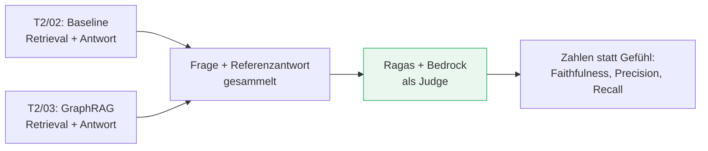

# Evaluation & Qualität

###### tag-3/02-evaluation-qualitaet · Tag 3 · Kapitel 02

"Fühlt sich gut an" ist keine Metrik — Ragas macht RAG-Qualität messbar

**Tag 3 · Kapitel 02**

<!--
Tag 3 · Kapitel 02 · Folie 1/6 (Titel)

Rahmen setzen: Seit T2/02 bauen wir RAG-Pipelines und bewerten sie nach Gefühl ("klingt richtig"). T2/03 hat sogar explizit versprochen, GraphRAG heute an der Baseline zu messen. Heute lösen wir das Versprechen ein.
-->

---

# Warum jetzt erst? Weil es vorher nichts zu messen gab

###### tag-3/02-evaluation-qualitaet · Tag 3 · Kapitel 02



- **Faithfulness**: Behauptet die Antwort etwas, das der Kontext nicht hergibt? (0–1, höher = besser)
- **Context Precision**: Ist der gefundene Kontext relevant für die Frage/Referenz?
- **Context Recall**: Deckt der gefundene Kontext die Referenzantwort vollständig ab?
- Alle drei brauchen: Frage, Antwort, **abgerufenen Kontext**, **Referenzantwort** — genau das, was T2/02 Teil 2 und T2/03 Teil 3 als "Fragenkatalog fürs Ragas-Evaluieren" schon sammeln ließen

<!--
Tag 3 · Kapitel 02 · Folie 2/6 (Warum jetzt)

Betonen: Das ist kein neuer Aufwand, sondern das Einlösen eines Datensatzes, der schon in der Schublade liegt. Wer die T2-Übungen gemacht hat, hat die Referenzantworten schon.
-->

---

# Ragas: aktueller Stand (Juli 2026, live geprüft)

###### tag-3/02-evaluation-qualitaet · Tag 3 · Kapitel 02

```python
from ragas.metrics.collections import Faithfulness, ContextPrecision, ContextRecall

metric = Faithfulness(llm=judge)                 # judge: unser Bedrock-Wrapper
result = metric.score(
    user_input=question, response=answer, retrieved_contexts=contexts,
)
print(result.value)   # 0.0–1.0
```

- **Wichtig:** `from ragas.metrics import faithfulness` (ohne `.collections`) funktioniert noch, ist aber **deprecated** und verschwindet in Ragas 1.0 — wir nutzen von Anfang an den neuen Pfad
- Metrik-Klassen brauchen einen **`InstructorBaseRagasLLM`** als Judge — kein rohes SDK-Objekt, sondern einen über die [`instructor`-Bibliothek](https://python.useinstructor.com/) "gepatchten" Client
- **Versions-Falle, live gefunden:** `ragas` bricht mit dem neuesten `langchain-community` (entfernter Importpfad, [offener Bug](https://github.com/vibrantlabsai/ragas/issues/2745)) — Fix: `langchain-community<0.4` explizit anpinnen

<!--
Tag 3 · Kapitel 02 · Folie 3/6 (Ragas aktueller Stand)

Diese Folie existiert nur, weil beim Vorbereiten dieses Kapitels genau dieser Import gebrochen ist — nicht aus einem Tutorial abgeschrieben, sondern selbst durchprobiert. Das darf man den Teilnehmern auch so erzählen: Doku und Realität klaffen bei schnelllebigen Bibliotheken auseinander, deshalb selbst testen.
-->

---

# LLM-as-Judge mit Bedrock verdrahten

###### tag-3/02-evaluation-qualitaet · Tag 3 · Kapitel 02

```python
import boto3, instructor
from ragas.llms.base import InstructorLLM

client = instructor.from_bedrock(boto3.client("bedrock-runtime"),
                                  model=MODEL_ID, async_client=True)   # ①
judge = InstructorLLM(client=client, model=MODEL_ID, provider="bedrock",
                       temperature=0.0, max_tokens=1024)
del judge.model_args["top_p"]                                          # ②
```

Zwei Stolpersteine, nur durch echte Bedrock-Aufrufe gefunden — nicht aus der Doku ablesbar:

| # | Fehler ohne den Fix | Ursache |
|---|---|---|
| ① | `Cannot use agenerate() with a synchronous client` | Ragas ruft Metriken immer async auf — der instructor-Client muss `async_client=True` sein |
| ② | `temperature and top_p cannot both be specified` | Ragas' Default schickt beide Parameter; Bedrock akzeptiert nur einen — `top_p` nach dem Bauen löschen |

**Kein eigener Ragas-Bedrock-Adapter existiert** — der Weg führt über `instructor`, das Bedrock direkt unterstützt (`pip install instructor[bedrock]`).

<!--
Tag 3 · Kapitel 02 · Folie 4/6 (LLM-as-Judge verdrahten)

Diese Folie ist das Herzstück — beide Fehler live nachstellen, wenn Zeit ist (Fehlertext einmal ohne Fix zeigen). Genau das ist "Doku prüfen, bevor sie in der Theorie behauptet wird" aus den Kapitel-Grundregeln in der Praxis.
-->

---

# Was Faithfulness in der Praxis unterscheidet

###### tag-3/02-evaluation-qualitaet · Tag 3 · Kapitel 02

| Antwort | Kontext | Faithfulness |
|---|---|---|
| "An der Algarve gibt es flache Buchten, ideal zum Baden mit Kindern." | "Die Buchten bei Lagos sind flach und geschützt, ideal zum Planschen." | **0.5–1.0** (je nach Formulierungs-Nähe) |
| "In den Stubaier Alpen gibt es einen Kinderstrand mit Palmen." | (derselbe Algarve-Kontext) | **0.0** — frei erfunden |

- Live getestet: eine erfundene Antwort bekommt **zuverlässig 0.0**, eine gestützte Antwort **0.5–1.0** — die Metrik unterscheidet tatsächlich, sie liefert nicht einfach immer denselben Wert
- **Context Precision/Recall messen das Retrieval**, Faithfulness die **Generierung** — eine hohe Hit-Rate (T2/02) mit niedriger Faithfulness zeigt: das Problem liegt im Prompt oder Modell, nicht in der Suche

<!--
Tag 3 · Kapitel 02 · Folie 5/6 (Faithfulness in der Praxis)

Die 0.0-vs-hoch-Tabelle beweist den Teilnehmern, dass die Metrik nicht nur eine Zahl ausspuckt, sondern wirklich diskriminiert — wichtig für Vertrauen ins Werkzeug, bevor es gleich zur Kernfrage des Kapitels kommt.
-->

---

# Demo & Übung

###### tag-3/02-evaluation-qualitaet · Tag 3 · Kapitel 02

**Demo:** Die T2/02-Baseline auf ihrem eigenen Fragenkatalog bewerten — drei Metriken, ein Judge, echte Bedrock-Aufrufe.

**Übung:** Die eigentliche Prüfung — **Baseline vs. GraphRAG, auf denselben Fragen, mit denselben Metrik-Instanzen.** Seit T2/03 steht die Behauptung "GraphRAG liefert bessere Antworten" im Raum. Heute bekommt sie eine Zahl. Ob die Zahl die Behauptung stützt: **selbst messen, nicht vorwegnehmen** — das Ergebnis hängt vom Korpus ab, nicht von der Überzeugung, dass ein Graph "mächtiger" klingt.

<!--
Tag 3 · Kapitel 02 · Folie 6/6 (Demo & Übung)

Bewusst KEINE Zahl vorwegnehmen — die Übung verlangt explizit "Ergebnis aufschreiben, bevor ihr weiterlest". Wer die Theorie hier schon verrät, zerstört den Lerneffekt der Übung.
-->
