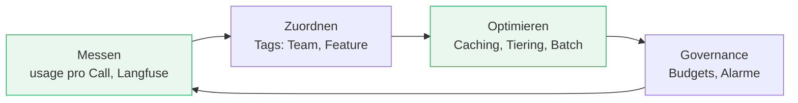

# Kosten & FinOps

###### tag-3/04-kosten-finops · Tag 3 · Kapitel 04

Token-Ökonomie: messen, nicht schätzen

**Tag 3 · Kapitel 04**

<!--
Tag 3 · Kapitel 04 · Folie 1/7 (Titel)

Anknüpfen an die "überraschende Rechnung" aus Übung 01 (TravelMate). Heute machen wir aus dem diffusen "LLMs sind teuer" konkrete Zahlen — und zeigen drei Hebel, die den Preis um Größenordnungen senken.
-->

---

# Warum GenAI-Kosten anders sind

###### tag-3/04-kosten-finops · Tag 3 · Kapitel 04

| Klassische Cloud | GenAI |
|---|---|
| Kosten ≈ Instanz-Stunden, planbar | Kosten ≈ **Tokens pro Anfrage**, variabel |
| Lastspitze = mehr Server | Lastspitze = linear mehr Token-Kosten |
| Optimierung: Rightsizing | Optimierung: **weniger/billigere Tokens** |

- Der Kostentreiber ist **pro Aufruf** und hängt von Prompt-Größe, Modell und Antwortlänge ab — nicht von einer Instanz
- **Gute Nachricht:** Diese Kosten sind vollständig **messbar** — jede `converse`-Antwort liefert `usage` (Tokens rein/raus, Cache). Wir haben das seit Tag 1 mitgeschrieben
- Nutzungsbasiert heißt auch: **kein Leerlaufpreis** (anders als die Neo4j-EC2-Instanz — die einzige Stundenpreis-Ressource der Schulung)

<!--
Tag 3 · Kapitel 04 · Folie 2/7 (Warum anders)

Rückbezug auf Tag 3/01: Wir tracen bereits Tokens pro Call in Langfuse — FinOps ist kein neuer Datenstrom, sondern eine andere Auswertung derselben Traces. Und Langfuse rechnet die Kosten sogar automatisch aus (Kapitel 01, live gezeigt).
-->

---

# Hebel 1: Prompt Caching — live gemessen

###### tag-3/04-kosten-finops · Tag 3 · Kapitel 04

```python
system=[{"text": KNOWLEDGE_BASE},          # großer, stabiler Prefix
        {"cachePoint": {"type": "default"}}]   # ← alles davor wird gecacht
```

| | Cache-Write (1. Call) | Cache-Read (Folge-Call) |
|---|---|---|
| Preis-Faktor auf Input | **1,25×** | **0,10×** |
| In der Demo gemessen | voller Preis | **~10 % der Kosten** |

- **Breakeven ~30 %:** Wird derselbe Prefix in unter ~30 % der Anfragen wiederverwendet, kosten die 1,25×-Writes mehr, als die Reads sparen ([Prompt Caching Doku](https://docs.aws.amazon.com/bedrock/latest/userguide/prompt-caching.html))
- TTL: **5 Minuten** (Default) oder **1 Stunde** (seit Jan 2026, Write dann 2×) — ideal für einen stabilen System-Prompt/Kontext, der über viele Anfragen gleich bleibt
- **Falle:** `inputTokens` in `usage` schließt Cache-Tokens **aus** — wer nur die summiert, unterschätzt die Rechnung

<!--
Tag 3 · Kapitel 04 · Folie 3/7 (Prompt Caching)

Die 10 %-Zahl ist echt gemessen (caching.py), nicht aus einem Blog. Live vorführen, wenn Zeit ist — der Cache-Read-Effekt ist sofort im usage-Block sichtbar. Breakeven betonen: Caching ist kein Gratis-Gewinn, bei seltener Wiederverwendung sogar teurer.
-->

---

# Hebel 2: Modell-Tiering — Qualität hat einen Preis

###### tag-3/04-kosten-finops · Tag 3 · Kapitel 04

Live gemessen, gleiche Aufgabe (Support-Nachricht klassifizieren):

| Modell | Antwort | Kosten |
|---|---|---|
| **Haiku** | `zahlung` | **1×** |
| **Sonnet** | `**zahlung**` (+ Erklärung) | **~10×** |

- Für Klassifikation, Extraktion, Routing ist der **billige Tier meist gleichwertig** — das teure Modell "über-erklärt" hier sogar
- Das ist der **Model-Router aus T2/01** als Kostenhebel: pro Aufgabentyp das billigste ausreichende Modell
- Regel: **erst mit dem billigen Tier bauen**, nur bei messbar schlechterer Qualität (Ragas, Tag 3/02!) auf den teureren wechseln — nicht umgekehrt

<!--
Tag 3 · Kapitel 04 · Folie 4/7 (Modell-Tiering)

Die 10x-Zahl ist echt (tiering.py). Der Bogen schließt sich: T2/01 Router (wie), T3/02 Evaluation (Qualität messbar), T3/04 Kosten (Preis messbar) — zusammen die Entscheidungsgrundlage "billigstes Modell, das die Eval besteht".
-->

---

# Hebel 3 & Governance

###### tag-3/04-kosten-finops · Tag 3 · Kapitel 04

- **Batch Inference:** für nicht-interaktive Massen-Jobs (Nightly-Re-Embedding, große Auswertungen) bietet Bedrock [Batch-Verarbeitung mit ~50 % Rabatt](https://docs.aws.amazon.com/bedrock/latest/userguide/batch-inference.html) — die async-Jobs aus T2/04 sind genau die Kandidaten
- **`maxTokens` als Airbag:** begrenzt die teuerste Variable (Antwortlänge) und stoppt Missbrauchs-/Endlos-Prompts (LLM10 aus Kapitel 03)
- **Governance = dieselben AWS-Werkzeuge wie immer:**
  - [Cost Allocation Tags](https://docs.aws.amazon.com/awsaccountbilling/latest/aboutv2/cost-alloc-tags.html) (`project`/`owner` — schon seit Tag 1 in `app.py`)
  - [AWS Budgets](https://docs.aws.amazon.com/cost-management/latest/userguide/budgets-managing-costs.html) mit Alarm (Trainer-Runbook, pro Teilnehmer-Account)
  - **Ehrlich:** AWS kann Ausgaben **nicht hart deckeln** — Budgets alarmieren nur; ein harter Stopp bräuchte eigene Automatik (Budget-Action → IAM-Deny)

<!--
Tag 3 · Kapitel 04 · Folie 5/7 (Hebel 3 & Governance)

Batch nur erwähnt, nicht demonstriert (async-Setup + Wartezeit sprengt das Kapitel) — ehrlich als "dokumentiert, hier nicht vorgeführt" kennzeichnen. Der harte-Deckel-Punkt kam schon in Tag 1/03 (Kosten-Radar) — hier die technische Auflösung: Budget-Action kann IAM-Deny auslösen.
-->

---

# Die FinOps-Schleife

###### tag-3/04-kosten-finops · Tag 3 · Kapitel 04



- **Messen zuerst** — ohne `usage`-Daten (Tag 1) und Traces (Tag 3/01) ist jede Optimierung geraten
- Optimieren ist ein **Architektur-Thema**: Wo sitzt der Cache-Point? Welcher Task auf welchem Tier? Was läuft als Batch? — Entscheidungen, keine Konfigurationsdetails
- Kosten sind eine **Qualitätsdimension** wie Latenz — gehören ins Monitoring, nicht in eine Quartalsüberraschung

<!--
Tag 3 · Kapitel 04 · Folie 6/7 (FinOps-Schleife)

Die Schleife zeigt, dass FinOps kein einmaliges Aufräumen ist. Wichtigster Pfeil: Messen → alles andere. Die Teilnehmer haben die Messung schon (Tag 1 usage, Tag 3/01 Traces) — heute kommt die Optimierungs- und Governance-Seite dazu.
-->

---

# Demo & Übung

###### tag-3/04-kosten-finops · Tag 3 · Kapitel 04

**Demo:** Prompt Caching (gecachter Call ~10 % der Kosten) und Modell-Tiering (Sonnet ~10× teurer für dieselbe Klassifikation) — beides an echten Bedrock-Zahlen gemessen, plus ein `cost.py`, das aus `usage` echte USD rechnet.

**Übung:** Baut einen **Kosten-Report** für einen Fragen-Mix: pro Frage Modell wählen (Router), `usage` messen, USD ausrechnen — und den Effekt von Caching und Tier-Wahl über den ganzen Mix beziffern. Zusatz: eine Budget-Action skizzieren, die bei Überschreitung wirklich stoppt.

**Kosten heute:** die ganze Übung kostet Cent-Bruchteile — passenderweise das billigste Kapitel der Schulung.

<!--
Tag 3 · Kapitel 04 · Folie 7/7 (Demo & Übung)

Übergang zu Tag 3/05 (Deployment): Wir haben jetzt eine Anwendung, die beobachtbar, evaluiert, abgesichert und kostenbewusst ist. Im letzten Kapitel bringen wir sie in Produktion — CDK-Pipeline und AgentCore Runtime.
-->
