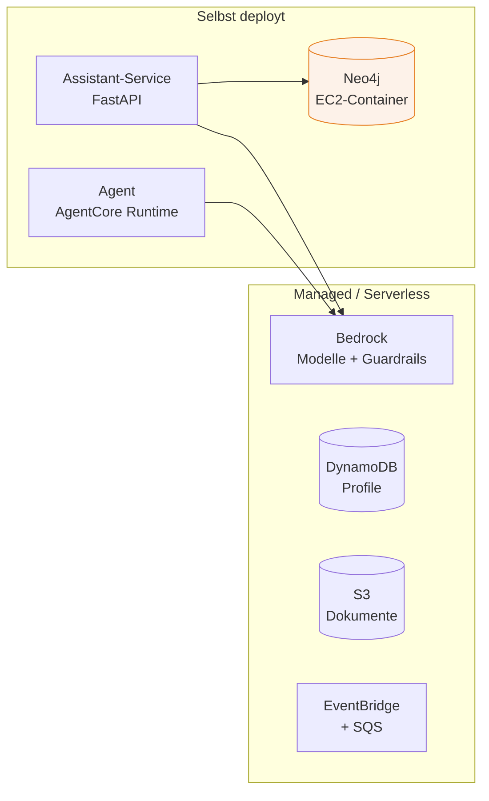

# Deployment & Betrieb

###### tag-3/05-deployment-betrieb · Tag 3 · Kapitel 05

Die Anwendung aus drei Tagen in Produktion bringen

**Tag 3 · Kapitel 05**

<!--
Tag 3 · Kapitel 05 · Folie 1/7 (Titel)

Abschluss der Schulung: Wir haben eine Anwendung, die event-getrieben, kontext-fähig, beobachtbar, evaluiert, abgesichert und kostenbewusst ist. Jetzt bringen wir sie deploybar in die Cloud — und schließen den offenen Punkt "Neo4j auf EC2" aus Tag 1.
-->

---

# Was wo läuft: das Deployment-Zielbild

###### tag-3/05-deployment-betrieb · Tag 3 · Kapitel 05



- **Managed-Dienste** brauchen kein Deployment — sie sind da (Bedrock, DynamoDB, S3, EventBridge). Nutzungsbasiert, kein Betrieb
- **Selbst deployt** wird nur, was einen Prozess/Container braucht: der Service, Neo4j (die **einzige Stundenpreis-Ressource**), der Agent
- Faustregel: **so viel managed wie möglich** — jedes selbst betriebene Stück ist Aufwand und Kosten

<!--
Tag 3 · Kapitel 05 · Folie 2/7 (Deployment-Zielbild)

Die Farbe hebt Neo4j hervor: die einzige Box mit Stundenpreis. Alles andere ist nutzungsbasiert. Diese Unterscheidung ist die wichtigste Deployment-Entscheidung — sie bestimmt Betriebsaufwand und Kostenprofil.
-->

---

# Infrastructure as Code: Neo4j auf EC2

###### tag-3/05-deployment-betrieb · Tag 3 · Kapitel 05

```python
instance = ec2.Instance(self, "Neo4j",
    instance_type=ec2.InstanceType.of(ec2.InstanceClass.T4G, ec2.InstanceSize.SMALL),
    machine_image=ec2.MachineImage.latest_amazon_linux2023(
        cpu_type=ec2.AmazonLinuxCpuType.ARM_64),
    user_data=user_data)   # startet denselben neo4j:5.26-Container wie lokal
```

- **Derselbe Container wie im `docker-compose.yml`** — kein Cloud-Spezialfall, das "lokal = Cloud"-Prinzip aus Tag 1 zu Ende gedacht
- **Kostenfallen vermieden** (Kosten-Radar!): `nat_gateways=0` + Public Subnet statt teurem NAT Gateway, `t4g.small` (ARM, ~0,50 $/Tag), Volume mit `delete_on_termination`
- **Sicherheit in der Infrastruktur:** Bolt/Browser nur für die Teilnehmer-CIDR, **nie** `0.0.0.0/0` für eine DB — die Security Group, nicht die Hoffnung, schützt

<!--
Tag 3 · Kapitel 05 · Folie 3/7 (IaC Neo4j)

Das schließt den offenen Punkt aus Tag 1. Betonen: derselbe Container, den sie seit Tag 1 lokal laufen haben — nur die Umgebung wechselt. Kein Neptune, kein Umschreiben. In der Demo den Stack synthen und die Assertions zeigen.
-->

---

# `cdk synth` ist kein Beweis — Assertions sind es

###### tag-3/05-deployment-betrieb · Tag 3 · Kapitel 05

```python
def test_no_nat_gateway_is_created() -> None:
    template = Template.from_stack(Neo4jStack(App(), "Neo4j", allowed_cidr="203.0.113.0/24"))
    template.resource_count_is("AWS::EC2::NatGateway", 0)   # die Kostenfalle beweisbar aus
```

- `cdk synth` zeigt nur, dass der Code **compiliert** — nicht, dass er das Richtige tut
- [`aws_cdk.assertions`](https://docs.aws.amazon.com/cdk/api/v2/python/aws_cdk.assertions/README.html) prüft das erzeugte CloudFormation-Template: Instanztyp, kein NAT Gateway, CIDR-Beschränkung, Wegwerf-Volume — **offline, ohne Deploy**
- Das ist eine **Projekt-Regel**: kritische Properties bekommen einen Assertions-Test. Sicherheit und Kosten sind kritisch
- Läuft im **CI** — jede Änderung an der Infrastruktur wird geprüft, bevor sie deployt wird

<!--
Tag 3 · Kapitel 05 · Folie 4/7 (Assertions)

Das ist der methodische Kern: Infrastruktur wird getestet wie Anwendungscode. Der negative Test (kein NAT Gateway, kein 0.0.0.0/0) ist besonders wertvoll — er beweist die ABWESENHEIT eines Fehlers, nicht nur die Anwesenheit einer Eigenschaft.
-->

---

# Der Agent auf AgentCore Runtime

###### tag-3/05-deployment-betrieb · Tag 3 · Kapitel 05

- [Amazon Bedrock AgentCore Runtime](https://docs.aws.amazon.com/bedrock-agentcore/latest/devguide/what-is-bedrock-agentcore.html): serverlose Laufzeit für Agenten — framework-agnostisch (Strands, LangGraph, …), kein Server-Betrieb
- Deployment-Weg: Agent-Code wird als **arm64-Container** paketiert, nach **ECR** gepusht, AgentCore Runtime hostet ihn und bietet einen Invoke-Endpoint — der Build läuft über CodeBuild (kein lokales Docker nötig)
- Werkzeug: die [AgentCore CLI](https://github.com/aws/agentcore-cli) (`@aws/agentcore`) ist der aktuell empfohlene Weg (löst das ältere Starter-Toolkit ab)
- **Ehrlich, was wir hier NICHT tun:** Wir deployen den Agenten in dieser Schulung **nicht** live — AgentCore Observability ist noch **Preview** (Tag 3/01), und der volle Deploy-Zyklus sprengt das Kapitel. Der Strands-Agent aus T2/05 ist deploy-**fähig**, den Deploy führt ihr nach der Schulung mit der CLI aus

<!--
Tag 3 · Kapitel 05 · Folie 5/7 (AgentCore Runtime)

Kritische Ehrlichkeit nach der CLAUDE.md-Regel: nicht behaupten, wir hätten den Agenten deployt. Wir zeigen den WEG (Container → ECR → Runtime) und benennen, dass Observability Preview ist. Wer es live will, macht es nach der Schulung — der Agent ist vorbereitet. Lieber ehrlich "nicht vorgeführt" als eine unbelegte Behauptung.
-->

---

# Rollout & Fallback: alles ist ein versioniertes Artefakt

###### tag-3/05-deployment-betrieb · Tag 3 · Kapitel 05

| Artefakt | Version | Rollout-Strategie |
|---|---|---|
| **Modell-ID** | Config/Env (Tag 1) | neues Modell = Config-Change, kein Redeploy |
| **Prompt** | `_V3` im Repo (T2/01) | A/B über zwei Prompt-Versionen |
| **Guardrail** | `DRAFT` → `1`, `2` (T3/03) | neue Policy erst als DRAFT testen |
| **Infra** | CDK + Git | `cdk diff` vor jedem Deploy |

- **Fallback ist schon gebaut** (T2/04): Throttling → 503 + Retry-After, Modell-Fehler → 502, `refused` → 200 — der Aufrufer kann reagieren
- **Kein Big-Bang:** Modell/Prompt/Guardrail sind entkoppelt deploybar — ein schlechtes neues Modell wird durch einen Config-Change zurückgerollt, nicht durch einen Redeploy
- Degradation statt Ausfall: fällt Bedrock aus, liefert der GET-Pfad (T1/06) trotzdem das vorberechnete Profil aus der DB

<!--
Tag 3 · Kapitel 05 · Folie 6/7 (Rollout & Fallback)

Der rote Faden der ganzen Schulung kulminiert hier: Modell = Config, Prompt = Artefakt, Guardrail = Version, Infra = Code. Alles einzeln, versioniert, zurückrollbar deploybar. Das IST "AI-ready" — nicht ein cleveres Modell, sondern ein System, das Modelle sicher konsumiert und wechselt.
-->

---

# Demo, Übung & Abschluss

###### tag-3/05-deployment-betrieb · Tag 3 · Kapitel 05

**Demo:** Der Neo4j-EC2-Stack — kostenbewusst gebaut, per Assertions bewiesen, per `synth` gezeigt. Kein Deploy (Stundenpreis!), aber vollständig verifiziert.

**Übung:** Erweitert den Stack (Verschlüsselung, ein zweiter SSM-Parameter, ein IAM-Recht) und **beweist jede Änderung per Assertion**. Zusatz: den AgentCore-Deploy-Befehl recherchieren und die Schritte dokumentieren.

**Abschluss der Schulung:** Von "was ist AI-Ready-Architektur" (Tag 1) über Events, Daten, GraphRAG, Agenten (Tag 1–2) bis zu Observability, Evaluation, Sicherheit, Kosten und Deployment (Tag 3) — eine durchgängige Anwendung, die KI **sicher konsumiert**, nicht trainiert.

<!--
Tag 3 · Kapitel 05 · Folie 7/7 (Abschluss)

Letzte Folie der Schulung: den Bogen von Tag 1 Kapitel 1 zurückholen (AI-Ready-Merkmale als Checkliste). Jede der 6 Eigenschaften ist jetzt gebaut. Zeit für Fragen, Retrospektive, "was nehmt ihr mit". Danach cdk destroy nicht vergessen.
-->
